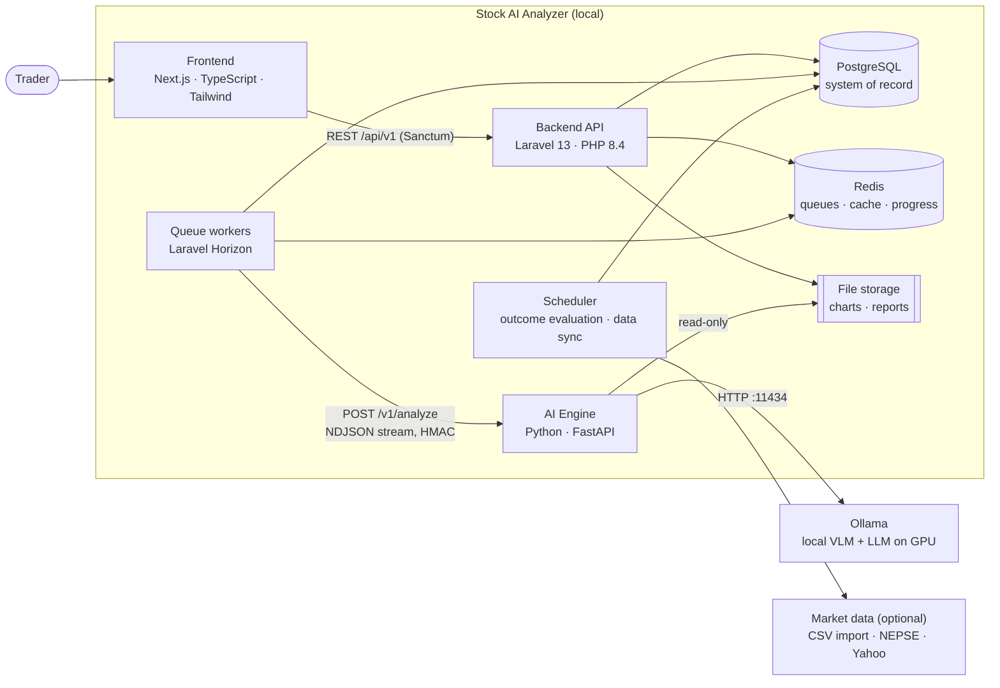
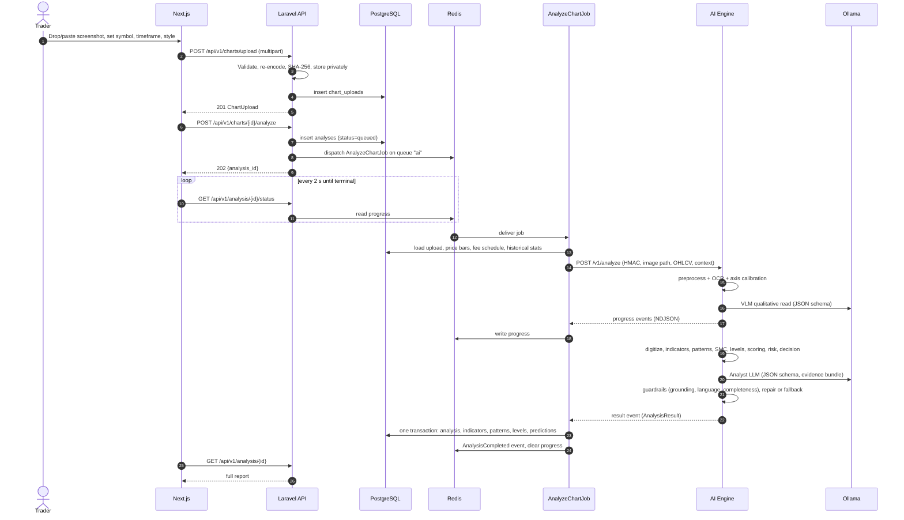
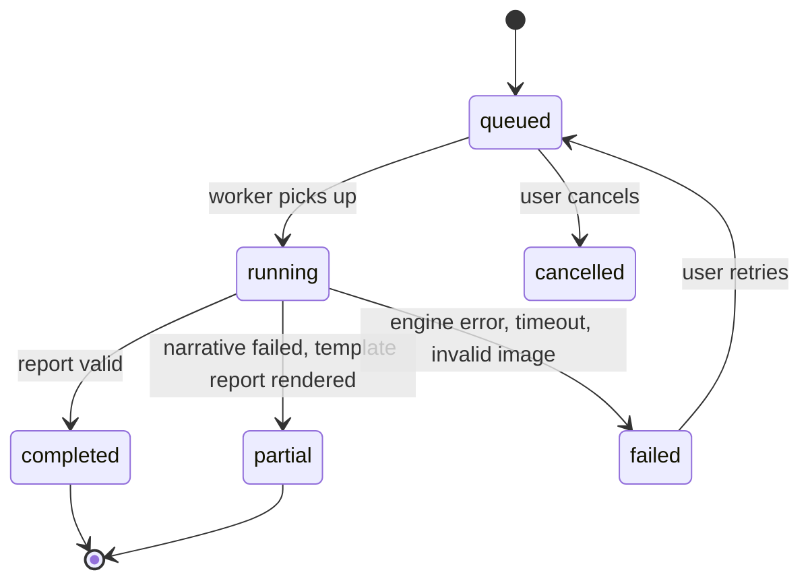
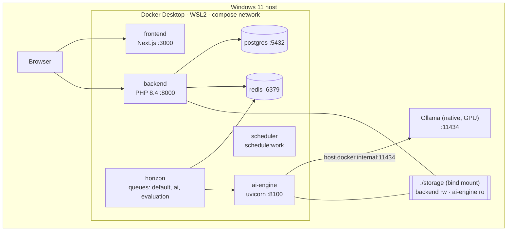
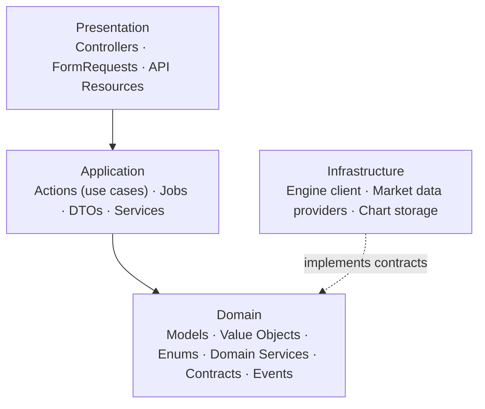

# System Architecture

## 1. System context



**Responsibilities**

| Component | Owns | Does not |
|-----------|------|----------|
| Frontend | UI, client validation, polling, chart overlays | Business rules, calculations |
| Laravel API | Auth, uploads, persistence, market data, predictions, outcome evaluation, journal, stats | Image analysis, indicator math, LLM calls |
| Horizon workers | Running `AnalyzeChartJob`, `EvaluatePredictionsJob`, `SyncMarketDataJob` | — |
| AI Engine | Vision, digitization, indicators, patterns, SMC, scoring, risk, decision policy, report generation, guardrails | Persistence, auth, scheduling. It has no database and no Redis |
| Ollama | Model serving | — |
| PostgreSQL | All durable state | — |
| Redis | Queues, cache, analysis progress, rate-limit counters | Durable state |

## 2. Runtime flow: analyzing a chart



### Analysis state machine



A watchdog (scheduled every 5 min) marks `running` analyses older than `timeout + 60 s` as `failed` with `WORKER_LOST`, so nothing stays stuck.

## 3. Deployment (local development on Windows 11)



- **Ollama runs natively**, not in Docker, for direct GPU access on Windows. Containers reach it at `host.docker.internal:11434`.
- **Laravel runs in a container** because Horizon requires the `pcntl` and `posix` extensions, which native Windows PHP lacks.
- Only the frontend and backend ports need to be reachable from the browser. The ai-engine port is published in dev for debugging only.
- The same `docker-compose.yml`, minus dev port publishing, is the starting point for a single-server commercial deployment. In the cloud, the storage bind mount becomes S3/MinIO with presigned URLs.

## 4. Architecture decisions (ADR summary)

| # | Decision | Rationale | Revisit when |
|---|----------|-----------|--------------|
| 01 | **Hybrid evidence: LLMs never produce numbers** | VLMs misread axes and hallucinate levels; deterministic code is testable | Never, for numbers |
| 02 | **Engine is a stateless HTTP service; Laravel is the system of record** | One owner of data; the engine is easy to test, scale and relocate | — |
| 03 | **Laravel calls the engine from a queued job; the engine streams NDJSON progress and result** | No cross-language queue protocol (Laravel job payloads are PHP-serialized); the engine needs no Redis; progress flows through the worker | Multiple GPU workers: move to a Redis Streams job protocol |
| 04 | **`ai` queue concurrency = 1; engine semaphore = 1** | One GPU runs one VLM/LLM job well; parallel jobs thrash VRAM | More GPUs |
| 05 | **No LangChain/LangGraph** | The pipeline is a fixed DAG; a framework adds dependency weight and hides control flow | Open-ended tool-using agents are needed |
| 06 | **Indicators implemented in-house (numpy/pandas), verified against TA-Lib in tests** | No native build dependency on Windows; full control over edge cases; TA-Lib stays a test-only oracle | — |
| 07 | **Market data owned by Laravel (providers + CSV import) and passed to the engine in the request** | The engine stays pure; bars are persisted once and reused for outcome evaluation | — |
| 08 | **Pragmatic DDD: Eloquent models live in the Domain layer; interfaces only at real boundaries** | A generic repository over Eloquent is ceremony without benefit. Boundaries that change (AI engine, market data, storage) get contracts | A second persistence mechanism appears |
| 09 | **Laravel, Horizon and the scheduler run in Docker/WSL2** | Horizon needs `pcntl`/`posix` | — |
| 10 | **Frontend polls status every 2 s in the MVP** | Simple and robust; progress changes at most every few seconds | Many concurrent users: Laravel Reverb |
| 11 | **Storage through Laravel filesystem disks; engine receives a relative path** (local) or a presigned URL (cloud) | One abstraction for local and S3 | — |
| 12 | **Every analysis stores engine, prompt and model versions** (digest-pinned) | Reproducibility; calibration is per engine version | — |
| 13 | **Contracts are generated, not hand-copied**: Pydantic → JSON Schema → Laravel contract tests; Laravel → OpenAPI (Scramble) → TypeScript types | Type safety across three languages | — |
| 14 | **Enums stored as `varchar` + CHECK constraint, mapped to PHP backed enums** | Native Postgres enums make migrations painful | — |

## 5. Laravel layering



Dependency rule: Presentation → Application → Domain. Infrastructure implements Domain contracts and is bound in a service provider. Domain code never imports Infrastructure.

## 6. Folder structure

### 6.1 Repository root

```
stock-ai-analyzer/
├── docs/                     Phase 1 design package
├── frontend/                 Next.js app
├── backend/                  Laravel app (owns the DB schema: backend/database/migrations)
├── ai-engine/                Python FastAPI service
├── storage/
│   ├── charts/               uploaded screenshots (private; backend rw, ai-engine ro)
│   └── reports/              exported reports
├── infra/
│   ├── docker/               Dockerfiles: php, python, node
│   ├── postgres/             init.sql (extensions: pg_trgm for symbol search)
│   └── scripts/              benchmark-ollama, backup-db, dev helpers
├── docker-compose.yml
├── .env.example
└── README.md
```

### 6.2 Backend (Laravel)

```
backend/app/
├── Domain/
│   ├── Shared/
│   │   ├── ValueObjects/     Price, Percentage, RiskReward, Money
│   │   └── Enums/            Timeframe, TradingStyle, Direction
│   ├── Market/
│   │   ├── Models/           Exchange, Stock, PriceBar
│   │   ├── ValueObjects/     Symbol, FeeSchedule, TradingCalendar
│   │   └── Services/         TradingCostCalculator
│   ├── Chart/
│   │   ├── Models/           ChartUpload
│   │   └── Enums/            UploadStatus, ChartPlatform
│   ├── Analysis/
│   │   ├── Models/           Analysis, AnalysisIndicator, AnalysisPattern, AnalysisLevel, AnalysisFeedback
│   │   ├── Enums/            AnalysisStatus, Bias, Decision, DataTier, PatternType
│   │   ├── Contracts/        AnalysisEngine
│   │   ├── Events/           AnalysisCompleted, AnalysisFailed
│   │   └── Exceptions/       EngineUnavailable, EngineTimeout, InvalidEngineResult, NotAChart
│   ├── Prediction/
│   │   ├── Models/           Prediction, Outcome, CalibrationSnapshot
│   │   ├── Enums/            PredictionStatus, OutcomeResult, TriggerType
│   │   └── Services/         PredictionEvaluator (pure; walks bars → Outcome)
│   └── Journal/
│       ├── Models/           TradeJournalEntry
│       └── Services/         TradeMetricsCalculator (P&L, R, fees), PlanVsExecution
├── Application/
│   ├── Actions/              UploadChart, RequestAnalysis, PersistAnalysisResult, RecordTrade,
│   │                         CloseTrade, ResolvePredictionManually, ImportPriceBars
│   ├── DTOs/                 AnalysisRequestData, EngineResultData, UploadChartData (readonly classes)
│   ├── Jobs/                 AnalyzeChartJob, EvaluatePredictionsJob, SyncMarketDataJob, StuckAnalysisWatchdog
│   └── Services/             PerformanceStatsService, CalibrationService, HistoricalContextBuilder
├── Infrastructure/
│   ├── AI/                   PythonEngineClient (implements AnalysisEngine), NdjsonStreamReader,
│   │                         EngineRequestSigner, EngineResultMapper
│   ├── MarketData/           Contracts/MarketDataProvider, CsvPriceImporter, NepseProvider, YahooProvider
│   ├── Storage/              ChartStorage (validate, re-encode, hash, path strategy)
│   └── Queue/                job middleware (analysis-level locks), Horizon tagging
├── Presentation/
│   └── Http/
│       ├── Controllers/Api/V1/  ChartUploadController, AnalysisController, HistoryController,
│       │                        TradeController, PredictionController, StatsController, StockController
│       ├── Requests/            UploadChartRequest, AnalyzeChartRequest, StoreTradeRequest, CloseTradeRequest, ...
│       ├── Resources/           ChartUploadResource, AnalysisResource, AnalysisSummaryResource, TradeResource, ...
│       └── Middleware/
└── Providers/                   DomainServiceProvider (binds contracts → infrastructure)

backend/database/{migrations, factories, seeders}
backend/tests/{Unit, Feature, Contract}      Pest
```

Packages: `laravel/sanctum`, `laravel/horizon`, `intervention/image` (re-encoding), `dedoc/scramble` (OpenAPI); dev: `larastan/larastan`, `pestphp/pest`, `laravel/pint`, `laravel/telescope` (local only).

### 6.3 AI Engine (Python)

```
ai-engine/
├── pyproject.toml                 managed with uv; ruff, mypy --strict, pytest
├── config/
│   ├── scoring.yaml               factor weights and thresholds per style (versioned)
│   ├── styles.yaml                horizon, ATR buffers, max stop, min R:R
│   ├── patterns.yaml              geometric tolerances
│   └── models.yaml                hardware profiles → model tags and digests
├── contracts/                     JSON Schemas exported from Pydantic (committed, used by Laravel tests)
├── ai_engine/
│   ├── main.py                    FastAPI app factory
│   ├── settings.py                pydantic-settings
│   ├── api/                       routes: /health, /v1/models, /v1/analyze (NDJSON), HMAC verification
│   ├── pipeline/
│   │   ├── orchestrator.py        runs the DAG, timings, progress events
│   │   ├── context.py             PipelineContext (immutable stage outputs)
│   │   └── evidence.py            EvidenceStore (assigns E1..En, lookups for grounding)
│   ├── agents/
│   │   ├── vision_agent.py        OCR + VLM → ChartContext
│   │   ├── technical_agent.py
│   │   ├── pattern_agent.py
│   │   ├── smc_agent.py
│   │   ├── bull_bear_agent.py
│   │   ├── risk_agent.py
│   │   ├── decision_policy.py
│   │   └── analyst_agent.py
│   ├── analysis/                  pure functions, no I/O
│   │   ├── indicators.py          EMA, RSI (Wilder), MACD, ADX/DI, ATR, OBV, volume SMA
│   │   ├── swings.py              fractal pivots, ATR zigzag (shared by patterns and SMC)
│   │   ├── levels.py              S/R clustering, strength
│   │   ├── patterns.py            classic pattern templates
│   │   ├── candlesticks.py
│   │   ├── smc.py                 structure, BOS/CHoCH, FVG, OB, liquidity, premium/discount
│   │   ├── scoring.py             factor model
│   │   └── risk.py                entries, stops, targets, R:R, costs, sizing
│   ├── vision/
│   │   ├── preprocess.py          normalize, detect theme, crop panes
│   │   ├── ocr.py                 RapidOCR (ONNX) wrapper, token boxes
│   │   ├── axis_calibration.py    price-axis label fit (linear/log), date axis
│   │   └── candle_extractor.py    color segmentation → OHLC(V)
│   ├── models/
│   │   ├── ollama.py              client: timeouts, retries, JSON-schema output, keep_alive
│   │   ├── vision.py              VLM wrapper with structured prompts
│   │   └── registry.py            hardware profile → models
│   ├── prompts/                   versioned templates (vision_read.v1.md, analyst.v1.md, repair.v1.md)
│   ├── guardrails/
│   │   ├── grounding.py           every number must match evidence
│   │   ├── language.py            banned certainty phrases
│   │   └── completeness.py        required sections, scenario pairs, decision consistency
│   ├── reports/
│   │   ├── generator.py           structured report → Markdown
│   │   └── templates/             Jinja2: report.md.j2, fallback.md.j2
│   └── schemas/                   Pydantic: request, chart_context, series, evidence, report, result
└── tests/
    ├── unit/                      indicators (vs TA-Lib), swings, patterns (synthetic shapes), risk, policy
    ├── pipeline/                  orchestrator with a fake Ollama client (tests only)
    ├── eval/                      offline harness over the golden screenshot set
    └── fixtures/{charts, ohlcv, expected}
```

Dependencies: fastapi, uvicorn, pydantic v2, pydantic-settings, numpy, pandas, scipy, opencv-python-headless, rapidocr-onnxruntime, httpx, jinja2, pyyaml, structlog. Dev/test: pytest, hypothesis, TA-Lib (oracle), mypy, ruff.

### 6.4 Frontend (Next.js)

```
frontend/src/
├── app/
│   ├── (auth)/login/page.tsx
│   └── (app)/
│       ├── dashboard/page.tsx
│       ├── analyze/page.tsx
│       ├── analyses/[id]/page.tsx
│       ├── forecast/page.tsx
│       ├── history/page.tsx
│       ├── journal/page.tsx · journal/[id]/page.tsx
│       ├── performance/page.tsx
│       └── settings/page.tsx
├── features/                  upload · analysis · scanner · forecast · journal · performance (hooks, API calls, components)
├── components/
│   ├── ui/                    shadcn/ui primitives
│   ├── charts/                ScreenshotOverlay (SVG over image), PriceChart (lightweight-charts)
│   └── report/                DecisionPanel, ScenarioCard, FactorList, TradePlan, EvidenceTable
├── lib/
│   ├── api/                   fetch client (Sanctum CSRF), generated OpenAPI types
│   └── format.ts              NPR/currency, percentages, exchange-timezone dates
└── styles/
```

Libraries: TanStack Query (server state and polling), Zod plus react-hook-form (forms), shadcn/ui (Radix + Tailwind), lightweight-charts, react-dropzone.

## 7. Cross-cutting concerns

### 7.1 Error taxonomy

| Code | Raised by | Retry | User-facing message |
|------|-----------|-------|---------------------|
| `INVALID_IMAGE` | Upload / engine | No | "This file couldn't be read as an image." |
| `NOT_A_CHART` | Vision agent | No | "This doesn't look like a price chart." |
| `SYMBOL_MISMATCH` | Chart-identity stage | No: re-running repeats it | "The screenshot is a chart of X, but the analysis was requested for Y." Offers the relink form |
| `ENGINE_UNAVAILABLE` | Job | Yes: 2 tries, 30 s backoff | "The analysis engine is offline. Retrying." |
| `ENGINE_TIMEOUT` | Job | Yes, once | "Analysis took too long." |
| `MODEL_UNAVAILABLE` | Engine | No | "Model `qwen2.5vl:7b` isn't installed. Run `ollama pull qwen2.5vl:7b`." |
| `MODEL_OUTPUT_INVALID` | Engine | Internal repair, then template fallback → `partial` | Report shown with a "narrative unavailable" note |
| `INSUFFICIENT_DATA` | Engine | No | Tier C report with the reason |
| `WORKER_LOST` | Watchdog | User retry | "Analysis was interrupted." |

### 7.2 Job configuration

- `AnalyzeChartJob`: queue `ai`, `tries = 2`, `timeout = 900 s`, `backoff = 30 s`. The Redis connection's `retry_after` (960 s) must exceed the timeout, otherwise jobs run twice.
- Idempotent: the job exits without work if the analysis is already terminal. Results persist in one DB transaction.
- Horizon supervisors: `ai` (1 process), `evaluation` (1), `default` (2).

### 7.3 Security

- **Uploads**: MIME sniffing (not the extension); size and dimension limits; re-encode to PNG (drops EXIF and polyglot payloads); store on a private disk at `charts/{user_id}/{yyyy}/{mm}/{ulid}.png`; serve only through an authorized route.
- **Engine calls**: `X-Signature: HMAC-SHA256(timestamp + body)` with a shared secret; reject timestamps outside ±5 min. The engine only reads paths under the storage root (path traversal guard).
- **API**: Sanctum SPA cookie auth, CSRF, CORS limited to the frontend origin, policies on every resource (users see only their own data), rate limits (upload 20/min, analyze 10/min).
- **Secrets**: `.env` only, never committed; `.env.example` documents them.

### 7.4 Observability

- The analysis ULID is the correlation id in Laravel logs, engine logs (`X-Request-Id`), and Horizon tags.
- Per-stage timings are stored in `analyses.evidence->timings` and shown on an internal debug panel.
- The engine's `/health` reports Ollama reachability, which models are installed, and GPU/VRAM info.

### 7.5 Configuration and versioning

`engine_version` = package version + hash of `config/*.yaml`. `prompt_version` = hash of the prompt templates. Model tags are pinned by digest in `models.yaml`. All three are stored on every analysis, and calibration statistics are computed per engine version.
