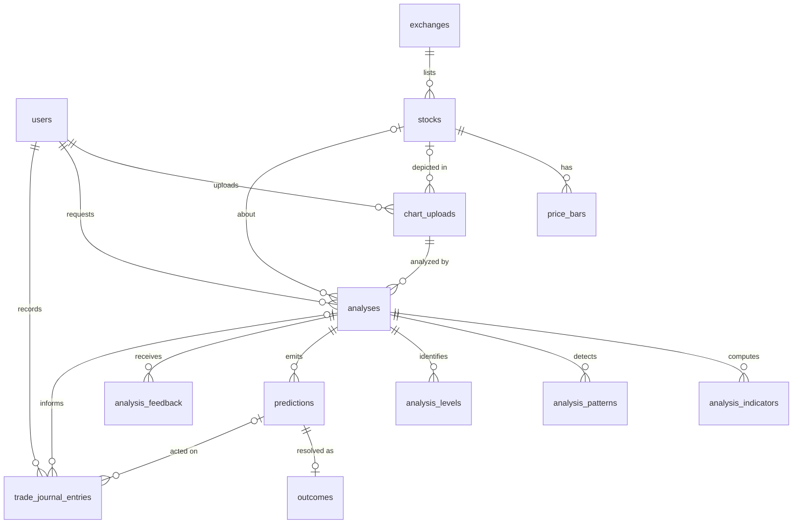
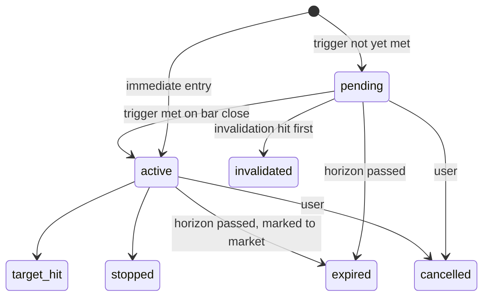

# Database Schema (PostgreSQL)

## 1. Conventions

- **IDs**: ULID (`char(26)`, Laravel `HasUlids`) for user-facing entities (`chart_uploads`, `analyses`, `predictions`, `trade_journal_entries`), so URLs are non-enumerable. `bigint` identity for reference and high-volume tables.
- **Prices**: `numeric(14,4)`. **Percentages**: `numeric(8,4)`. **Scores**: `smallint` with CHECK. Never floats for money.
- **Time**: `timestamptz`, stored in UTC and displayed in the exchange timezone (Asia/Kathmandu for NEPSE).
- **Enums**: `varchar` plus a CHECK constraint, mapped to PHP backed enums (ADR-14).
- **JSON**: `jsonb` for evidence bundles and flexible metadata only. Anything queried for stats gets its own column.
- **Deletes**: soft deletes on `chart_uploads`, `analyses` and `trade_journal_entries`. Predictions and outcomes are never hard-deleted, so the track record can't be cherry-picked.
- Laravel system tables (`sessions`, `cache`, `jobs`, `failed_jobs`, `password_reset_tokens`, `personal_access_tokens`) use their defaults.

## 2. Entity-relationship diagram

Mapping to the brief: Users → `users` · Stocks → `stocks` · ChartUploads → `chart_uploads` · Analyses → `analyses` · Indicators → `analysis_indicators` · Patterns → `analysis_patterns` · TradeJournal → `trade_journal_entries` · Predictions → `predictions` · Outcomes → `outcomes`.
Added: `exchanges`, `price_bars`, `analysis_levels`, `analysis_feedback`, `calibration_snapshots` (reasons in [00-README](00-README.md#where-this-deviates-from-the-brief-and-why)).

## 3. Tables

### 3.1 `users`
Laravel default columns (`id`, `name`, `email`, `password`, `email_verified_at`, `remember_token`, timestamps), plus:

| Column | Type | Null | Notes |
|--------|------|------|-------|
| timezone | varchar(64) | no | default `Asia/Kathmandu` |
| default_exchange_id | bigint FK → exchanges | yes | |
| settings | jsonb | no | `{account_size, currency, risk_per_trade_pct, max_position_pct, default_style, min_rr_override, model_profile}` validated by a settings DTO |

### 3.2 `exchanges`
| Column | Type | Null | Notes |
|--------|------|------|-------|
| id | bigint PK | | |
| code | varchar(16) | no | unique: `NEPSE`, `NASDAQ`, `NSE` |
| name | varchar(120) | no | |
| country | char(2) | no | `NP` |
| timezone | varchar(64) | no | `Asia/Kathmandu` |
| currency | char(3) | no | `NPR` |
| trading_days | jsonb | no | ISO weekdays, e.g. NEPSE Mon–Fri `[1,2,3,4,5]` (it moved off Sun–Thu in April 2026) |
| session_open / session_close | time | no | local exchange time |
| price_band_pct | numeric(5,2) | yes | daily circuit band (configurable, verify current rule) |
| tick_size | numeric(10,4) | no | |
| allows_short_selling | boolean | no | NEPSE: `false` |
| fee_schedule | jsonb | no | broker commission tiers, regulator fee, DP charge, CGT rates by holding period. Every value is configuration, seeded with values to verify |
| holidays | jsonb | no | list of closed dates (maintained by a seeder or admin) |
| timestamps | | | |

### 3.3 `stocks`
| Column | Type | Null | Notes |
|--------|------|------|-------|
| id | bigint PK | | |
| exchange_id | bigint FK | no | |
| symbol | varchar(20) | no | uppercase |
| name | varchar(200) | no | |
| sector | varchar(100) | yes | |
| instrument_type | varchar(20) | no | CHECK in (`equity`,`mutual_fund`,`debenture`,`index`,`etf`) |
| is_active | boolean | no | default true |
| metadata | jsonb | no | default `{}` |
| timestamps | | | |

Unique `(exchange_id, symbol)`. GIN trigram index on `symbol` and `name` for autocomplete.

### 3.4 `price_bars`
| Column | Type | Null | Notes |
|--------|------|------|-------|
| id | bigint PK | | |
| stock_id | bigint FK | no | |
| timeframe | varchar(8) | no | `1D`, `1W`, `1h`, … |
| bar_time | timestamptz | no | bar open time |
| open / high / low / close | numeric(14,4) | no | CHECK `low <= least(open,close)` and `high >= greatest(open,close)` |
| volume | numeric(20,2) | yes | |
| turnover | numeric(20,2) | yes | NEPSE provides it |
| source | varchar(24) | no | `csv`, `nepse`, `yahoo`, `merolagani` |
| created_at | timestamptz | | |

Unique `(stock_id, timeframe, bar_time)`, which also serves range scans. Digitized bars are **not** stored here; they live in the analysis evidence and never contaminate real data. Partition by year, or use TimescaleDB, only if the table exceeds ~50M rows.

### 3.5 `chart_uploads`
| Column | Type | Null | Notes |
|--------|------|------|-------|
| id | ulid PK | | |
| user_id | bigint FK | no | |
| stock_id | bigint FK | yes | set once the symbol is resolved |
| declared_symbol | varchar(20) | yes | as typed by the user |
| symbol_confirmed | boolean | no | default false. The user has vouched that this screenshot really is `stock_id`, which is what waives the engine's chart-identity check. Cleared whenever the chart is re-pointed at another ticker |
| declared_exchange | varchar(16) | yes | |
| declared_timeframe | varchar(8) | yes | |
| declared_style | varchar(16) | yes | |
| disk | varchar(32) | no | `charts` |
| path | varchar(512) | no | |
| original_filename | varchar(255) | yes | |
| mime_type | varchar(64) | no | after re-encode: `image/png` |
| size_bytes | integer | no | |
| width / height | integer | no | |
| sha256 | char(64) | no | |
| platform | varchar(24) | yes | detected: `tradingview`, `nepse_chart`, `other` |
| status | varchar(16) | no | `uploaded`, `analyzing`, `analyzed`, `failed`, `rejected` |
| timestamps, deleted_at | | | |

Index `(user_id, created_at desc)`; unique `(user_id, sha256)` where `deleted_at is null` (dedupe).

### 3.6 `analyses`
| Column | Type | Null | Notes |
|--------|------|------|-------|
| id | ulid PK | | |
| user_id | bigint FK | no | |
| chart_upload_id | ulid FK | no | |
| stock_id | bigint FK | yes | |
| timeframe | varchar(8) | no | effective (after confirmation) |
| trading_style | varchar(16) | no | |
| position_status | varchar(8) | no | `none`, `holding` |
| position_entry_price | numeric(14,4) | yes | |
| position_quantity | numeric(14,2) | yes | |
| user_thesis | text | yes | |
| status | varchar(12) | no | `queued`, `running`, `completed`, `partial`, `failed`, `cancelled` |
| current_stage | varchar(32) | yes | |
| data_tier | varchar(12) | yes | `ohlcv` (A), `digitized` (B), `vision_only` (C) |
| data_quality | numeric(4,3) | yes | 0–1 |
| as_of | timestamptz | yes | last bar visible in the chart; outcome evaluation starts **after** this |
| last_price | numeric(14,4) | yes | |
| bias | varchar(8) | yes | `bullish`, `bearish`, `neutral` |
| setup_score | smallint | yes | CHECK 0–100 |
| calibrated_probability | numeric(4,3) | yes | null until calibrated |
| decision | varchar(8) | yes | `buy`, `wait`, `hold`, `sell`, `avoid` |
| decision_limited | boolean | no | true when Tier C limited the decision |
| narrative_source | varchar(12) | yes | `llm`, `template` |
| report | jsonb | yes | structured report ([04 §7](04-ai-agent-workflow.md#7-analyst-agent-llm)) |
| report_markdown | text | yes | |
| evidence | jsonb | yes | full evidence bundle, chart context, timings (reproducibility) |
| warnings | jsonb | no | default `[]` |
| engine_version / prompt_version | varchar(64) | yes | |
| models | jsonb | yes | `{vision: "qwen2.5vl:7b@sha256:…", llm: "…"}` |
| error_code | varchar(40) | yes | |
| error_message | text | yes | |
| queued_at / started_at / completed_at | timestamptz | | |
| duration_ms | integer | yes | |
| timestamps, deleted_at | | | |

Indexes: `(user_id, created_at desc)`, `(stock_id, created_at desc)`, `(status)` partial where status in (`queued`,`running`), `(decision)`.

### 3.7 `analysis_indicators` (Indicators)
| Column | Type | Null | Notes |
|--------|------|------|-------|
| id | bigint PK | | |
| analysis_id | ulid FK cascade | no | |
| key | varchar(32) | no | `ema_21`, `rsi_14`, `macd_12_26_9`, `adx_14`, `atr_14`, `rvol_20`, `obv` |
| name | varchar(16) | no | `ema`, `rsi`, … |
| params | jsonb | no | `{"period":21}` |
| value | numeric(18,6) | yes | primary value; null if unavailable |
| components | jsonb | yes | `{macd, signal, hist}`, `{adx, plus_di, minus_di}` |
| signal | varchar(8) | yes | `bullish`, `bearish`, `neutral` |
| status | varchar(12) | no | `computed`, `vision_read`, `unavailable` |
| unavailable_reason | varchar(200) | yes | "needs 200 bars; 118 available" |
| evidence_id | varchar(8) | yes | `E7` |

Unique `(analysis_id, key)`.

### 3.8 `analysis_patterns` (Patterns, including SMC structures)
| Column | Type | Null | Notes |
|--------|------|------|-------|
| id | bigint PK | | |
| analysis_id | ulid FK cascade | no | |
| category | varchar(12) | no | `classic`, `candlestick`, `smc` |
| type | varchar(40) | no | `double_bottom`, `ascending_triangle`, `bull_flag`, `bos`, `choch`, `fvg`, `order_block`, `liquidity_sweep`, `equal_highs`, … |
| direction | varchar(8) | no | `bullish`, `bearish`, `neutral` |
| status | varchar(12) | no | `forming`, `confirmed`, `failed`, `mitigated`, `unmitigated` |
| confidence | numeric(4,3) | no | 0–1 |
| detection_method | varchar(12) | no | `algorithmic`, `vision`, `both` |
| start_time / end_time | timestamptz | yes | |
| price_low / price_high | numeric(14,4) | yes | zone bounds (OB, FVG) or pattern range |
| key_points | jsonb | yes | pivots, neckline, trendline coefficients, breakout level |
| confirmation_rule | varchar(300) | yes | "Daily close above 580 with volume ≥ 1.5× 20-SMA" |
| measured_target | numeric(14,4) | yes | |
| invalidation_price | numeric(14,4) | yes | |
| evidence_id | varchar(8) | yes | |

Indexes `(analysis_id)`, `(category, type)`.

### 3.9 `analysis_levels`
| Column | Type | Null | Notes |
|--------|------|------|-------|
| id | bigint PK | | |
| analysis_id | ulid FK cascade | no | |
| type | varchar(16) | no | `support`, `resistance`, `liquidity`, `equilibrium`, `premium`, `discount` |
| price_low / price_high | numeric(14,4) | no | zone; equal for a line |
| strength | numeric(4,3) | no | touches, recency, volume |
| touches | smallint | yes | |
| source | varchar(16) | no | `pivots`, `volume_profile`, `smc`, `ocr_label` |
| pixel_y | integer | yes | for overlays (Tier A/B with calibration) |
| evidence_id | varchar(8) | yes | |

### 3.10 `predictions`
One analysis emits 1–4 predictions: a `directional_bias` statement plus one `trade_setup` per scenario with a valid plan.

| Column | Type | Null | Notes |
|--------|------|------|-------|
| id | ulid PK | | |
| analysis_id | ulid FK | no | |
| user_id | bigint FK | no | |
| stock_id | bigint FK | yes | null ⇒ manual evaluation only |
| kind | varchar(20) | no | `directional_bias`, `trade_setup` |
| scenario | varchar(12) | no | `primary`, `bullish`, `bearish` |
| direction | varchar(8) | no | `long`, `short`, `flat` |
| timeframe | varchar(8) | no | |
| trigger_type | varchar(16) | no | `immediate`, `close_above`, `close_below`, `touch` |
| trigger_price | numeric(14,4) | yes | |
| entry_price | numeric(14,4) | yes | |
| stop_price | numeric(14,4) | yes | |
| target_price_1 / target_price_2 | numeric(14,4) | yes | |
| invalidation_price | numeric(14,4) | yes | cancels a pending setup before trigger |
| reference_price | numeric(14,4) | no | close at `as_of` (baseline for directional evaluation) |
| as_of | timestamptz | no | |
| horizon_bars | smallint | no | from the style profile |
| expires_at | timestamptz | no | computed with the exchange trading calendar |
| setup_score | smallint | yes | |
| probability | numeric(4,3) | yes | calibrated, if available at creation |
| risk_reward | numeric(6,2) | yes | |
| status | varchar(12) | no | see state machine |
| activated_at / resolved_at | timestamptz | yes | |
| engine_version | varchar(64) | no | |
| timestamps | | | |

CHECK constraints: for `long` trade setups, `stop_price < entry_price < target_price_1`; the mirror for `short`. Index `(status, expires_at)` for the evaluator; `(stock_id, status)`.

### 3.11 `outcomes`
| Column | Type | Null | Notes |
|--------|------|------|-------|
| id | bigint PK | | |
| prediction_id | ulid FK | no | unique |
| result | varchar(16) | no | `win`, `loss`, `breakeven`, `expired`, `not_triggered`, `invalidated`, `no_data` |
| evaluation_method | varchar(8) | no | `auto`, `manual` |
| triggered_at / exit_at | timestamptz | yes | |
| exit_price | numeric(14,4) | yes | |
| return_pct | numeric(8,4) | yes | |
| r_multiple | numeric(6,2) | yes | |
| mfe_pct / mae_pct | numeric(8,4) | yes | max favorable / adverse excursion |
| bars_to_resolution | smallint | yes | |
| direction_correct | boolean | yes | for `directional_bias` |
| brier_component | numeric(6,5) | yes | (p − y)² |
| ambiguous_bar | boolean | no | stop and target in the same bar; counted as a loss (conservative) |
| evaluated_through | timestamptz | no | last bar considered |
| notes | text | yes | |
| timestamps | | | |

### 3.12 `trade_journal_entries` (TradeJournal)
| Column | Type | Null | Notes |
|--------|------|------|-------|
| id | ulid PK | | |
| user_id | bigint FK | no | |
| stock_id | bigint FK | no | |
| analysis_id | ulid FK | yes | |
| prediction_id | ulid FK | yes | |
| entry_chart_upload_id | ulid FK | yes | screenshot at entry |
| side | varchar(8) | no | `long` (`short` only where the exchange allows it) |
| status | varchar(10) | no | `planned`, `open`, `closed`, `cancelled` |
| entry_date | date | no | |
| entry_price | numeric(14,4) | no | |
| quantity | numeric(14,2) | no | |
| stop_loss | numeric(14,4) | yes | |
| target_price | numeric(14,4) | yes | |
| strategy | varchar(60) | yes | `breakout`, `pullback`, `ob_retest`, … |
| reason | text | no | |
| tags | jsonb | no | default `[]` |
| confidence_level | smallint | yes | 1–5, self-reported |
| exit_date | date | yes | |
| exit_price | numeric(14,4) | yes | |
| exit_reason | varchar(40) | yes | `target`, `stop`, `manual`, `time` |
| fees | numeric(14,2) | yes | computed from the fee schedule; can be overridden |
| gross_pnl / net_pnl | numeric(16,2) | yes | stored on close for fast stats |
| return_pct / r_multiple | numeric | yes | |
| followed_plan | boolean | yes | |
| lessons | text | yes | |
| timestamps, deleted_at | | | |

Index `(user_id, status)`, `(user_id, entry_date desc)`.

### 3.13 `analysis_feedback`
| Column | Type | Notes |
|--------|------|-------|
| id | bigint PK | |
| analysis_id | ulid FK | |
| user_id | bigint FK | unique with analysis_id |
| rating | smallint | −1 / +1 |
| issue_type | varchar(24) | `wrong_symbol`, `wrong_levels`, `wrong_pattern`, `misread_chart`, `not_useful`, `helpful` |
| comment | text | |
| created_at | timestamptz | |

### 3.14 `calibration_snapshots` (Phase 6)
| Column | Type | Notes |
|--------|------|-------|
| id | bigint PK | |
| engine_version | varchar(64) | |
| scope | varchar(40) | `global`, `style:swing`, `pattern:ascending_triangle` |
| method | varchar(16) | `isotonic`, `binned` |
| sample_size | integer | |
| brier_score | numeric(6,5) | |
| buckets | jsonb | `[{score_from, score_to, n, hit_rate}]` |
| created_at | timestamptz | |

## 4. Integrity rules enforced in the database

- FK `on delete restrict` for predictions and outcomes (the track record is immutable); `cascade` for analysis child rows.
- CHECK constraints: price positivity, OHLC consistency, score ranges, enum values, long/short price ordering.
- Unique constraints: stock symbol per exchange, one bar per stock/timeframe/time, one outcome per prediction, one feedback per user per analysis.

## 5. Factories and seeders

| Class | Purpose |
|-------|---------|
| `ExchangeSeeder` | NEPSE (Mon–Fri, Asia/Kathmandu, NPR, long-only, fee schedule placeholder marked *verify*), NASDAQ, NSE |
| `StockSeeder` | Imports the listed-company list from `database/seeders/data/nepse_stocks.csv` (HDL, NABIL, NTC, UPPER, …) |
| `UserSeeder` | One local owner account from `.env` (`OWNER_EMAIL`, `OWNER_PASSWORD`) |
| `UserFactory`, `StockFactory`, `ChartUploadFactory` | Tests |
| `PriceBarFactory` | Synthetic random-walk bars **for tests only** |
| `AnalysisFactory` (states `queued`, `completed`, `failed`) · `PredictionFactory` · `OutcomeFactory` · `TradeJournalEntryFactory` | Tests only |

Rule: **no seeder creates analyses, predictions or outcomes.** Test factories may, inside the test database. A development database never contains analysis output that the engine didn't produce, so no fake AI result ever appears in the UI.
