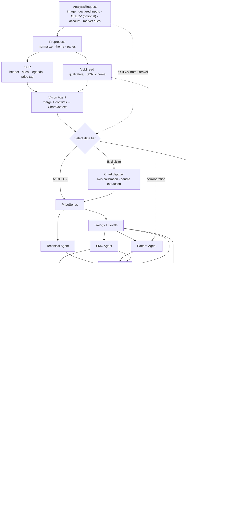
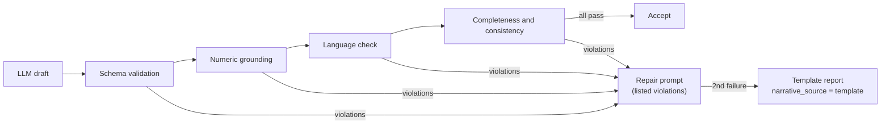
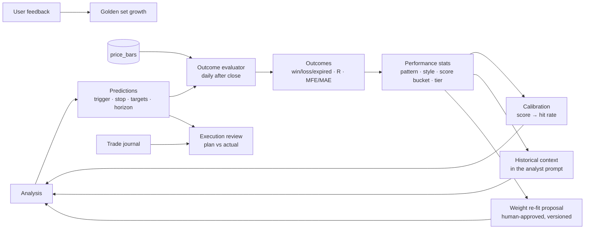

# AI Agent Workflow

## 1. Core principle: evidence first

> **Computation produces facts. Models produce perception and prose.**

| Agent | Type | Uses an LLM | Produces numbers |
|-------|------|-------------|------------------|
| Vision | Hybrid: OCR + VLM | VLM for qualitative reading only | Only numbers **read as text** by OCR (axis labels, legend values, price tag). Never VLM estimates |
| Chart digitizer | Deterministic computer vision | No | Yes: Tier B, approximate |
| Technical | Deterministic | No | Yes |
| Pattern | Deterministic geometry, plus VLM corroboration | Optional | Yes |
| SMC | Deterministic | No | Yes |
| Bull/Bear | Deterministic factor scoring | No | Scores |
| Risk | Deterministic | No | Yes |
| Decision policy | Deterministic rules | No | — |
| Analyst | LLM | Yes | **No.** Cites evidence only |
| Guardrails | Deterministic; one LLM repair attempt | Repair only | — |

Every fact produced by a deterministic stage is registered in the **EvidenceStore** and gets an id (`E1…En`). The analyst narrates evidence by id, and the guardrail rejects any number that isn't in the store.

## 2. Pipeline



The orchestrator runs this as a fixed DAG. Technical, Pattern and SMC run concurrently; they are CPU-cheap. Each stage emits a progress event and records its timing.

Ahead of all of it runs the **chart-identity check** (`identity`), the one part of the vision half that is built: it reads the chart's title and stops the run if the screenshot belongs to a different instrument than the request does. See §5.1.

## 3. Data tiers

| Tier | Selected when | Available | Limits |
|------|---------------|-----------|--------|
| **A — OHLCV** | Laravel supplied ≥ 60 bars for the resolved symbol and timeframe | Everything | None. `data_quality` reflects bar coverage |
| **B — Digitized** | Axis calibration R² ≥ 0.999 with ≥ 3 labels, ≥ 40 candles extracted, digitized last close within 1% of the OCR price tag | Indicators within available bars, patterns, SMC, levels, scoring, risk | Setup score scaled by `data_quality` (≤ 0.85). Levels shown as "≈", rounded to 2 significant decimals. EMA 200 usually unavailable unless read from the legend |
| **C — Vision only** | Neither of the above | Qualitative structure, visible indicators, OCR'd labels | No setup score and no trade plan. Decision limited to WAIT/HOLD (`decision_limited = true`). Any number shown is labeled "read from chart" |

**As-of alignment.** The analysis evaluates the chart *as the user saw it*. Tier A bars are sliced to the chart's last visible date (from the x-axis OCR). If that date can't be determined, the latest bar is used and a warning is raised.

**Cross-validation.** In Tier A, if the OCR'd last price differs from the OHLCV close at `as_of` by more than 2%, the engine raises `SYMBOL_OR_DATA_MISMATCH` and lowers `data_quality`. This usually means the wrong symbol or timeframe was declared.

**Symbol authority.** A declared symbol wins over an extracted one. A conflict is shown prominently, with one-click re-run. With no declared symbol, the extracted symbol is used if its confidence is ≥ 0.8; otherwise the symbol stays unresolved (Tier C).

## 4. Shared contracts (Pydantic → JSON Schema)

### 4.1 `ChartContext` (Vision Agent output)

```json
{
  "is_price_chart": true,
  "platform": "tradingview",
  "theme": "dark",
  "chart_type": "candles",
  "symbol":    {"value": "HDL", "confidence": 0.97, "source": "ocr_header", "declared": "HDL", "conflict": false},
  "exchange":  {"value": "NEPSE", "confidence": 0.90, "source": "ocr_header"},
  "timeframe": {"value": "1D", "confidence": 0.95, "source": "ocr_header", "declared": "1D", "conflict": false},
  "panes": [
    {"kind": "price", "bbox": [0, 40, 1780, 760]},
    {"kind": "volume", "bbox": [0, 760, 1780, 860]},
    {"kind": "indicator", "name": "RSI", "params": [14], "bbox": [0, 860, 1780, 1040]}
  ],
  "indicators_visible": [
    {"name": "EMA", "params": [50], "legend_value": 541.2, "source": "ocr_legend"},
    {"name": "RSI", "params": [14], "legend_value": 63.4, "source": "ocr_legend"}
  ],
  "price_axis": {"labels": [{"y": 112, "value": 600.0}, {"y": 331, "value": 560.0}], "scale": "linear",
                 "calibration": {"a": -0.18265, "b": 620.45, "r2": 0.99996}},
  "last_price": {"value": 552.1, "source": "ocr_price_tag"},
  "visible_date_range": {"from": "2026-03-02", "to": "2026-09-10", "source": "ocr_x_axis"},
  "qualitative": {
    "trend": "uptrend",
    "observations": ["higher highs", "higher lows since July", "volume expanding on up days"],
    "drawings_present": true,
    "source": "vlm"
  },
  "quality_issues": [],
  "warnings": []
}
```

This extends the brief's example: every field carries its **source** and **confidence**, and the qualitative observations come only from the VLM.

### 4.2 `EvidenceItem`

```json
{
  "id": "E14",
  "kind": "level",
  "key": "resistance_1",
  "value": 580.0,
  "value_high": 583.5,
  "unit": "price",
  "source": "pivots",
  "tier": "A",
  "as_of": "2026-09-10",
  "text": "Resistance zone 580–583.5, 4 touches since May, last rejection 2026-08-21"
}
```

### 4.3 Other contracts

`AnalysisRequest`, `PriceSeries` (bars plus source, tier, quality), `IndicatorResult`, `PatternResult`, `SmcResult`, `Level`, `FactorScore`, `Scenario`, `TradePlan`, `Decision`, `PredictionSpec`, `Report`, `AnalysisResult`. They live in `ai_engine/schemas/` and are exported to `ai-engine/contracts/*.schema.json` for Laravel contract tests.

## 5. Agent specifications

### 5.1 Vision Agent

> **Built today: the chart-identity check** (`ai_engine/agents/chart_identity_agent.py`, stage `identity`). The rest of this section is the Phase 4B design.
>
> The vision model is shown the screenshot and asked, blind, what instrument is printed on it — `is_price_chart`, `title`, `ticker`, `company_name`, nothing else. It is never told which symbol is expected, because asked "is this PCBL?" a 3B model agrees. The comparison against the request's `symbol`/`company_name` is plain Python in the same module: a ticker that the exchange's `symbol_universe` recognises and that is not the declared one, or a company name whose distinctive words (legal and industry words removed, near-matches allowed for a misread character) share nothing with the declared company's, raises `SYMBOL_MISMATCH` and the analysis stops. Anything less certain — an unreadable title, a ticker nobody recognises, a name like "Hydropower Ltd" that fits half the exchange — is a warning on the report, never a refusal.
>
> Nothing it reads enters the analysis: it is a gate, so a vision model's transcription can never become a number in a report. Without it, a mistyped or stale ticker produced a correct, well-evidenced report about the wrong company, and no stage could tell. Turn it off with `ENGINE_SYMBOL_CHECK_ENABLED=false` (it costs one extra model load per analysis).

**Purpose:** understand the screenshot: what is it, what does it show, and what text can be read reliably.

**Steps**
1. **Preprocess:** convert to RGB; detect theme from median luminance; find pane separators (long uniform horizontal lines) to split price, volume and indicator panes.
2. **OCR** (RapidOCR/ONNX, CPU): collect text tokens with bounding boxes and confidence. Classify each token by region:
   - header (top ~8%): symbol, exchange, timeframe, O/H/L/C values
   - right-edge column: price-axis labels; the highlighted box is the last price tag
   - bottom strip: date labels
   - pane legends: indicator names, parameters, values
3. **Parse:**
   - Symbol: fuzzy-match (rapidfuzz) against the exchange's stock list, which is included in the request.
   - Timeframe: normalize `1D | D | 1W | W | 240 | 4h | 60 | 1h | 15`.
   - Legends: parse `EMA 50 close 541.20`, `RSI 14 63.40`, `MACD 12 26 close 9 …`.
4. **VLM read** (Qwen-VL via Ollama, JSON-schema output, temperature 0). Prompt excerpt:
   ```text
   You are a chart-reading assistant. Describe ONLY what is visible in the image.
   - Do not estimate or state any price values.
   - If you are not sure about a field, return null.
   - Answer strictly in the provided JSON schema.
   ```
   Schema fields: `is_price_chart`, `chart_type` (candles / bars / line / heikin_ashi / renko), `trend_visual`, `observations[]` (constrained vocabulary plus free text), `patterns_visible[]` (enum), `drawings_present`, `indicator_names_visible[]`, `quality_issues[]` (cropped, crosshair tooltip, low resolution, overlapping drawings).
5. **Merge:** OCR wins for text and numbers; the VLM wins for qualitative fields. Compare declared and extracted values and set conflict flags.
   - Heikin-Ashi or renko charts: Tier B is disabled, because those aren't real OHLC.
   - Log-scale axis: calibration switches to log.
6. **Reject:** if `is_price_chart` is false and OCR finds no axis structure, raise `NOT_A_CHART`.

**Failure modes and handling:** crosshair tooltips hide candles (warn, lower quality); a cropped axis (no Tier B); a phone screenshot at low resolution (upscale ×2 before OCR); non-English UI (the OCR model is multilingual; parsers are locale-aware for numbers).

### 5.2 Chart digitizer (Tier B)

1. **Price-axis calibration.** Pair each axis label's y-center with its value and fit `price = a·y + b` with RANSAC. Also fit `ln(price) = a·y + b` and keep the better model. Require ≥ 3 inliers, R² ≥ 0.999 and monotonic labels.
2. **Candle colors.** k-means on the HSV values of saturated, non-background pixels in the price pane finds the up and down colors. The method adapts to the theme rather than assuming TradingView's teal and red. Indicator lines are excluded by shape: thin continuous curves, not vertical runs.
3. **Column scan.** For each x-column, find vertical runs of candle colors. Wide runs are bodies, thin runs are wicks. Group adjacent columns into candles and check spacing regularity via the median gap.
4. **OHLC.** Body top and bottom give open and close (by color); wick extremes give high and low. Pixels are mapped to prices with the calibration.
5. **Volume.** Bar heights in the volume pane give **relative** volume. Absolute volume is only available if the volume axis labels are readable.
6. **Dates.** Map x-axis date labels to bar indices using the exchange trading calendar; otherwise index-only.
7. **Validate.** Compare the digitized last close with the OCR price tag (≤ 1%), and high/low with the header values if visible. Require ≥ 40 candles. Compute `data_quality` from R², spacing regularity, the price-tag match and occlusion.

Documented limitation: accuracy is best on clean charts. The UI offers a "clean chart" tip (hide drawings, keep default colors).

### 5.3 Technical Agent

**Indicators** (implemented in `analysis/indicators.py` and verified against TA-Lib):

| Indicator | Definition | Available when |
|-----------|------------|----------------|
| EMA 9/21/50/200 | α = 2/(n+1), seeded with SMA(n) | bars ≥ n (flagged low-precision below 2n) |
| RSI 14 | Wilder smoothing | bars ≥ 30 |
| MACD 12/26/9 | EMA12 − EMA26; signal EMA9; histogram | bars ≥ 50 |
| ADX 14, +DI, −DI | Wilder | bars ≥ 42 |
| ATR 14 | Wilder true range | bars ≥ 20 |
| Volume SMA 20, RVOL | RVOL = volume / SMA20(volume) | bars ≥ 20, volume present |
| OBV | cumulative signed volume | volume present |

An indicator that can't be computed but is visible in the chart legend gets `status = vision_read` and uses the legend value, labeled as such. Otherwise it's `unavailable`, with the reason.

**Signals → evidence and factor inputs**
- **EMA alignment:** the fraction of ordered pairs in the bullish stack 9 > 21 > 50 (> 200).
- **Price location:** close relative to EMA 50 and EMA 200.
- **EMA slope:** EMA 21 slope over 5 bars, normalized by ATR.
- **RSI:** regime (pullbacks holding 40–50 = bullish regime; rallies failing at 50–60 = bearish regime); divergence against swing points; above 70 is reported as *context* ("overbought; in strong trends not a sell signal by itself").
- **MACD:** histogram sign and slope; line vs signal; position vs zero.
- **ADX:** above 25 = trending, amplifies trend factors; below 20 = ranging, dampens them.
- **Volume:** RVOL on the latest breakout bar; up-volume / down-volume ratio over 20 bars; OBV slope vs price slope (divergence).
- **Volatility:** ATR% regime, which feeds stop sizing.

**Output (summary):** `Trend: Bullish · Momentum: Positive · Volume: Confirming · Volatility: Normal (ATR 2.8%) · Risk: Medium`, plus evidence items and factor sub-scores in [−1, 1].

### 5.4 Pattern Agent

**Swings** (`analysis/swings.py`, shared with SMC): fractal pivots (n = 2 internal, n = 5 external) and an ATR zigzag (threshold 1.5 × ATR).

**Templates** (tolerances in `config/patterns.yaml`):

| Pattern | Geometry | Confirmation | Measured target | Invalidation |
|---------|----------|--------------|-----------------|--------------|
| Double bottom | Two swing lows within 0.5 × ATR, ≥ 8 bars apart; neckline ≥ 1.5 × ATR above; prior downtrend | Close > neckline | Neckline + (neckline − low) | Close < lower low |
| Double top | Mirror | Close < neckline | Mirror | Close > higher high |
| Head and shoulders | Three highs, head ≥ 1 × ATR above shoulders, shoulders within 1 × ATR; neckline through troughs | Close < neckline | Neckline − (head − neckline) | Close > right shoulder |
| Inverse H&S | Mirror | Close > neckline | Mirror | Close < right shoulder |
| Triangle (asc / desc / sym) | ≥ 2 highs and ≥ 2 lows, ≥ 5 touches; line-fit residual < 0.3 × ATR; classified by slopes; apex not passed | Close beyond the boundary, preferably before 75% of the way to the apex | Height at start, projected from the breakout | Close back inside plus opposite-boundary break |
| Flag | Pole ≥ 3 × ATR within ≤ 10 bars; 5–20 bar counter-channel retracing ≤ 50% | Close beyond the flag boundary | Pole length from the breakout | Retracement > 61.8% of the pole |
| Wedge (rising / falling) | Both boundaries slope the same way and converge | Break of the opposite boundary | Wedge start height | New extreme beyond the wedge |
| Channel | Parallel boundaries (slope difference < tolerance), ≥ 2 touches each | — (context) | Opposite boundary | Close outside the channel |
| Cup and handle | Rounded base (quadratic fit R² ≥ 0.8), depth 12–35%; handle ≤ ⅓ of cup depth, in the upper half | Close > handle high | Cup depth from the pivot | Close < handle low |

**Confidence** = 0.5 × geometric fit + 0.25 × volume conformity (e.g. volume contracting in the base, expanding on the breakout) + 0.25 × context (alignment with the prior trend). Forming patterns are capped at 0.70.

**VLM corroboration:** the VLM's `patterns_visible` enum is compared with the detections. Agreement sets `detection_method = both` (+0.05); disagreement is noted and changes nothing. In Tier C, VLM-only patterns are reported as "visual impression, unverified", with confidence capped at 0.40.

**Candlestick patterns** (engulfing, hammer, shooting star, pin bar) are only reported within 0.5 × ATR of a level, OB or FVG.

**Output (brief format):** `Detected pattern: Ascending triangle · Confidence 72% · Status: forming · Confirmation: daily close > 580 with volume ≥ 1.5× average · Target 640 · Invalidation: close < 548`.

### 5.5 SMC Agent

**Framing text**, inserted verbatim into every report:
> *Smart Money Concepts are a rule-based framework for reading price structure. The zones below are derived from price action alone; they do not reveal actual institutional orders or intentions.*

| Concept | Algorithmic definition |
|---------|------------------------|
| Swings | External: fractal 5. Internal: fractal 2 |
| HH / HL / LH / LL | Each swing compared with the previous swing of the same type |
| Structure state | Bullish after HH + HL; bearish after LH + LL |
| BOS | A **close** (not a wick) beyond the last external swing in the trend direction |
| CHoCH | The first close beyond the last swing *against* the prevailing structure |
| Displacement | Candle range ≥ 1.5 × ATR with body ≥ 60% of range |
| Order block | The last opposite-colored candle before the displacement leg that produced a BOS or CHoCH. States: unmitigated → mitigated (price returned) → invalidated (closed through) |
| Fair value gap | Bullish when `low[i+1] > high[i−1]`, minimum size 0.2 × ATR; mitigated at 50% fill (configurable) |
| Liquidity | Equal highs or lows within 0.1 × ATR (≥ 2 touches); prior external swings |
| Sweep | A wick beyond a liquidity level followed by a close back inside |
| Dealing range | From the last external swing low to high. Equilibrium at 50%; premium above, discount below; OTE 62–79% (optional) |

These feed three places: the structure and range-location factors in scoring, pullback entry zones (OB, FVG) in risk, and targets (liquidity pools).

### 5.6 Bull/Bear Agent (deterministic)

**Factor catalog** (priors for the swing style; per-style weights live in `config/scoring.yaml`):

| Factor | From | f = +1 when | f = −1 when | Weight |
|--------|------|-------------|-------------|--------|
| `trend_ema_alignment` | Technical | 9 > 21 > 50 (> 200) | Reverse stack | 0.15 |
| `price_location` | Technical | Close above EMA 50 and EMA 200 | Below both | 0.10 |
| `market_structure` | SMC | HH + HL, last event a bullish BOS | LH + LL, bearish BOS or CHoCH | 0.15 |
| `momentum_rsi` | Technical | Bullish regime, no bearish divergence | Bearish regime or bearish divergence | 0.10 |
| `momentum_macd` | Technical | Histogram > 0 and rising, above zero | Histogram < 0 and falling | 0.08 |
| `volume_confirmation` | Technical | Up-volume dominance; breakout RVOL ≥ 1.5 | Down-volume dominance (distribution) | 0.12 |
| `pattern` | Pattern | Confirmed bullish pattern (× confidence) | Confirmed bearish pattern | 0.12 |
| `room_to_move` | Levels | ≥ 2 × ATR to the next resistance | ≤ 0.5 × ATR to resistance, or a support break | 0.10 |
| `range_location` | SMC | Discount (f = 1 − 2p, where p is the position in the range) | Premium | 0.08 |

**Scoring**
1. Each fᵢ ∈ [−1, 1]. An unavailable factor is dropped and its weight redistributed proportionally; this is stated in the report.
2. **ADX modulation:** trend-type factor weights × 0.6 if ADX < 20, × 1.2 if ADX > 25; then renormalize.
3. `S = Σ wᵢ·fᵢ`, then `S_eff = S × q`, where q is `data_quality` (capped at 0.85 in Tier B).
4. **Setup score** = round(50 + 50 × S_eff), from 0 to 100.
5. **Bias:** bullish ≥ 60, bearish ≤ 40, otherwise neutral (thresholds configurable).
6. **Evidence agreement** = share of absolute weight agreeing with the bias, e.g. "74% of evidence weight agrees".

**Output (brief format)**
```
Bullish factors                      Bearish factors
✓ EMA alignment (+0.15) [E5]         ✗ Resistance nearby (−0.07) [E14]
✓ Volume increase (+0.10) [E9]       ✗ RSI bearish divergence (−0.05) [E11]
```

These weights are **documented priors, not truths.** Phase 6 re-fits them on outcomes, as a versioned proposal that needs your approval.

### 5.7 Risk Agent

**Style profiles** (`config/styles.yaml`, initial values):

| Style | Typical timeframe | Horizon | Stop buffer | Max stop distance | Min R:R (net) |
|-------|-------------------|---------|-------------|-------------------|---------------|
| Swing | 1D | 5–20 bars | 0.5 × ATR | 2.5 × ATR or 8% | 2.0 |
| Positional | 1D / 1W | 20–60 bars | 1.0 × ATR | 3.5 × ATR or 15% | 2.5 |
| Investing | 1W | 26–52 bars | 1.0 × ATR (weekly) | 20% | 3.0 |
| Intraday | ≤ 1h | 5–30 bars | 0.3 × ATR | 1.5 × ATR | 1.5 |

**Entry candidates (long)**
- **Breakout:** trigger is a close above the nearest resistance zone top; entry = trigger + 0.1 × ATR.
- **Pullback:** entry at the top of the nearest support, OB or FVG zone within 2 × ATR below price; confirmation is a bullish close from the zone.
- **At market:** only if a bullish trigger fired within the last 2 bars and price is within 1 × ATR of it.

**Stop:** below the structural invalidation (zone low or last HL) minus the style buffer. The plan is rejected if the stop is wider than the style maximum.

**Targets:** T1 is the nearest resistance or liquidity pool at least 1 × ATR above the entry. T2 is the next level or the pattern's measured move, whichever is more conservative.

**Metrics**
- risk% = (E − S) / E; reward% = (T1 − E) / E; R:R gross = (T1 − E) / (E − S)
- R:R net uses the round-trip cost c from the exchange fee schedule: `(T1 − E − c·E) / (E − S + c·E)`
- Quantity = ⌊ account × risk_pct / ((E − S) + per-share cost) ⌋, capped by `max_position_pct` and the lot size

**Worked example** (the brief's numbers):
```
Entry 550 · Stop 520 · Target 620
Risk    = 30 / 550 = 5.45%
Reward  = 70 / 550 = 12.73%
R:R     = 70 / 30  = 1 : 2.33 (gross; net is slightly lower after costs)
Account NPR 500,000 at 1% risk → NPR 5,000 / 30 = 166 shares (≈ NPR 91,300, 18.3% of account)
```

**Holding mode:** trailing stop = max(original stop, last HL − buffer); reports unrealized R and the exit conditions.

**Gates:** a plan is **viable** only if R:R net ≥ the style minimum and the stop is within the maximum distance. Non-viable plans are still shown, marked "not viable", with the reason and the price at which they would become viable (e.g. "a pullback to 548 gives R:R 2.1").

### 5.8 Outlook (measured horizons)

**Purpose:** answer "what about tomorrow, and this week" without inventing a forecast
(`ai_engine/analysis/outlook.py`, surfaced on the Forecast page — [forecast.md](forecast.md)).

For each horizon — 1 bar and 5 bars — over the **full** stored history, not the style window:

- `up_rate`: the share of N-bar moves that closed higher. Near half on most symbols, which is the
  point: it is the baseline a signal has to beat before it is an edge.
- `typical_move_pct`: the median absolute N-bar move.
- `low_move_pct` / `high_move_pct` and the price band they imply: the 10th and 90th percentiles. One
  move in five finished outside the band, by construction.
- `base_rates`: the candlestick signals firing on the last bar, re-measured **at that horizon**
  rather than the style's, because "within twenty bars" is not an answer to "tomorrow".

The first four are unconditional — they describe the instrument, not today's setup. Conditioning is
what base rates do, with their own sample attached; printing the two side by side is what makes a
signal's edge visible. Everything but `sample` is null below 60 completed moves, rather than drawing
percentiles through a handful of points.

Nothing here is fitted, smoothed or extrapolated, and no stage downstream may consume it: it is a
statement about the past, published next to the analysis rather than inside it.

## 6. Decision policy

Evaluated top-down; the first matching row wins. Thresholds live in `config/scoring.yaml`.

| # | Position | Condition | Decision |
|---|----------|-----------|----------|
| 1 | any | Symbol unresolved **or** Tier C | none → **WAIT**, holding → **HOLD**. `decision_limited = true`; no numeric plan |
| 2 | holding | Close below the position stop or the scenario invalidation | **SELL** (exit) |
| 3 | holding | Bearish CHoCH on the analysis timeframe **and** score ≤ 40 | **SELL** (exit) |
| 4 | holding | Otherwise | **HOLD**, with trailing stop and exit conditions |
| 5 | none | Score ≤ 40 | **AVOID** |
| 6 | none | Score ≥ 60, a viable long plan exists, **and** its trigger is already met | **BUY** |
| 7 | none | Score ≥ 60, a viable long plan exists, trigger not met | **WAIT**; conditions = the plan trigger |
| 8 | none | Score ≥ 60, but no viable plan (R:R or stop fails) | **WAIT**: "good chart, poor price"; conditions = price where the plan becomes viable |
| 9 | none | 40 < score < 60 | **WAIT**: "no edge"; lists what would change it |

The LLM never generates the decision fields. They are injected from the policy, and the analyst writes only the explanation.

## 7. Analyst agent (LLM)

**Input** (compact JSON, target < 8k tokens): the chart context summary; the evidence bundle (up to 60 items, prioritized by factor weight); factor scores; scenarios; trade plans; the fixed decision; historical context for similar setups; and, in the final section only, the user's thesis.

**Prompt rules** (`prompts/analyst.v1.md`):
```text
Role: senior equity research analyst, technical analyst and risk manager, writing for an experienced trader.
1. Use ONLY the evidence provided. Cite evidence ids in square brackets, e.g. [E7].
2. Do not introduce any number that is not in the evidence.
3. The decision is fixed: {decision}. Explain it; do not change or soften it.
4. Present scenarios conditionally: "If … then … ; invalid if …". Never state certainty.
5. For every recommendation state: why, evidence, risk, alternative scenario, invalidation.
6. Smart Money Concepts are a rule-based framework; never claim knowledge of institutional orders.
7. Data tier {tier}: if B, say levels are approximate; if C, give no trade plan.
8. If a user thesis is provided, assess it last: evidence for, evidence against.
```

**Generation settings:** Ollama structured output (`format` = the `Report` JSON schema), temperature 0.2, `num_ctx` 16k, thinking disabled for latency.

**`Report` schema** (LLM-written fields marked ✎; everything else is injected from structured data):
```json
{
  "schema_version": "1.0",
  "headline": "✎",
  "decision": {"action": "wait", "conditions": ["…"], "invalidation": 520.0, "explanation": "✎"},
  "bias": {"direction": "bullish", "setup_score": 70, "calibrated_probability": null, "note": "uncalibrated"},
  "sections": {
    "market_structure": {"text": "✎", "evidence": ["E3", "E4"]},
    "technical_view":   {"text": "✎", "evidence": ["E5", "E7", "E9"]},
    "pattern":          {"text": "✎", "evidence": ["E12"]},
    "smart_money":      {"text": "✎", "evidence": ["E15", "E16"], "framework_note": "…"},
    "support":          [{"low": 518.0, "high": 524.0, "strength": "strong", "evidence": ["E17"]}],
    "resistance":       [{"low": 580.0, "high": 583.5, "strength": "strong", "evidence": ["E14"]}]
  },
  "factors": {"bullish": ["…"], "bearish": ["…"]},
  "scenarios": [
    {"name": "bullish", "primary": true,  "trigger": "…", "targets": [620.0, 650.0], "invalidation": 548.0, "narrative": "✎"},
    {"name": "bearish", "primary": false, "trigger": "…", "targets": [500.0, 480.0], "invalidation": 583.5, "narrative": "✎"}
  ],
  "trade_plan": {"entry": {"type": "pullback", "price": 550.0}, "stop": 520.0, "targets": [620.0], "risk_pct": 5.45, "reward_pct": 12.73, "rr_gross": 2.33, "rr_net": null, "quantity": 166, "viable": true},
  "opinion": {"reason": "✎", "risk": "✎", "alternative_scenario": "✎", "what_would_change_view": ["✎"]},
  "user_thesis_review": {"for": ["✎"], "against": ["✎"]},
  "historical_context": null,
  "disclaimer": "…"
}
```
*(Values illustrative. `rr_net` is filled from the configured fee schedule.)*

## 8. Model strategy and hardware profiles

| Profile | Hardware | Vision model | Text model | Notes |
|---------|----------|--------------|------------|-------|
| `gpu_16gb` | ≥ 16 GB VRAM | `qwen2.5vl:7b` or `qwen3-vl:8b` | `qwen3:14b` | Both models stay loaded |
| `gpu_8gb` | 8–12 GB VRAM | `qwen2.5vl:7b` (Q4) | `qwen3:8b` | `OLLAMA_MAX_LOADED_MODELS=1`; models load sequentially (+5–15 s swap) |
| `gpu_4gb` | 4–6 GB VRAM, 16 GB RAM (**this machine: RTX 3050 Laptop 4 GB**) | `qwen2.5vl:3b` | `qwen3:4b` | One model loaded at a time; 7B models partially offload to CPU (slow). Vision is weaker, so OCR and Tier A carry the numbers. Benchmark decides |
| `cpu` | No GPU, ≥ 32 GB RAM | `qwen2.5vl:3b` | `qwen3:4b` | 5–15 min per analysis; weaker vision, so lean on OCR and Tier A |

- Alternatives: `llama3.2-vision:11b` (vision); `llava` (weaker at reading text in images); `deepseek-r1` distills (slow reasoning output, better suited as an optional critic than as the report writer).
- Tags change often. Phase 2's benchmark script confirms availability on your Ollama version, measures latency on real charts, and writes the chosen profile into `config/models.yaml` with **pinned digests**.
- Qwen-VL is the default vision family because it reads text in images noticeably better than LLaVA, and chart legends and axes are text.

## 9. Guardrails



1. **Schema:** Pydantic validation of the draft.
2. **Numeric grounding:** build the allowed set (evidence values, plan values, scenario levels, derived percentages, indicator parameters, sample sizes, dates) in every display precision. Extract every numeric token from the prose, including `1,250.50`, `5.4%`, `1:2.3` and ranges like `620–650`. Each token must equal an allowed value at its own precision. Any miss is a violation.
3. **Language:** reject certainty phrases (`will definitely`, `guaranteed`, `sure shot`, `cannot fail`, `risk-free`, `100%` outside evidence) and decision words contradicting the policy (e.g. "buy now" when the decision is WAIT).
4. **Completeness:** every required section is present and cites ≥ 1 evidence id; there are ≥ 2 scenarios in opposite directions, each with trigger and invalidation; `opinion` has all four fields; cited ids exist.
5. **Repair:** one retry, with the exact violations listed. A second failure renders the **template report** from structured data (`fallback.md.j2`) and sets the analysis status to `partial`. This isn't fake output: it's the same verified facts without the prose.

## 10. Learning loop



**Predictions created per analysis:** one `directional_bias` (Tier A/B), plus one `trade_setup` per viable plan. Tier C analyses create none automatically; they can be resolved manually.

**Outcome evaluator** (`Domain/Prediction/Services/PredictionEvaluator`, pure PHP, run daily after the NEPSE close):
```
bars = price_bars strictly after max(as_of, evaluated_through)
for bar in bars:
  if pending:
      if invalidation breached (close basis)      → invalidated; stop
      if trigger met (close_above: close > trigger; touch: high ≥ trigger)
          → active; fill = close (close trigger) or max(trigger, open) (touch)
  if active:
      update MFE / MAE from fill
      if open ≤ stop                              → stopped at open (gap)
      elif low ≤ stop and high ≥ T1               → stopped, ambiguous_bar = true (conservative)
      elif low ≤ stop                             → stopped at stop
      elif high ≥ T1                              → target_hit at T1 (T2 tracked for stats)
  if bars elapsed ≥ horizon                       → expired (active: mark to market at close)
directional_bias: at the horizon bar, y = close > reference_price; Brier = (setup_score/100 − y)²
```

**Metrics:** trigger rate; T1-before-stop hit rate with a Wilson 95% interval; expectancy (mean R); profit factor; MFE/MAE distributions; Brier score; calibration buckets (10-point score bands).

**What "learning" changes:**
1. **Calibrated probability:** shown once a bucket has n ≥ 30 (binned first, isotonic when n is large).
2. **Historical context:** e.g. "Your last 23 ascending-triangle breakouts (swing, NEPSE): 52% reached T1 before stop, mean +0.4R". Passed as evidence, so it's grounded too.
3. **Factor re-weighting:** logistic regression on factor vectors vs outcomes, with walk-forward validation. The output is a proposal diff to `scoring.yaml` that you approve, which bumps `engine_version`.
4. **Golden set growth:** "misread chart" feedback adds the screenshot to the vision evaluation set.
5. **Behavioral insights from the journal:** e.g. "You exited 7 of 11 winners before T1", "Stops moved in 4 trades". Deterministic statistics, not LLM speculation.

**Guards against self-deception:** only bars after `as_of` are used; predictions are immutable (only status changes, no deletes); stats are split by `engine_version`; minimum sample sizes; intervals are always shown; same-bar ambiguity counts as a loss.

No LLM fine-tuning in the MVP: there's too little data, overfitting is likely, and it would make behavior less inspectable.

## 11. Evaluation and testing of the AI

| Layer | Method | Gate |
|-------|--------|------|
| Indicators | Parity with TA-Lib on real NEPSE CSVs | ≤ 1e-6 after warm-up |
| Swings / patterns / SMC | Synthetic series with known shapes; hypothesis property tests (e.g. BOS never precedes its swing) | All fixtures pass |
| Risk and policy | Table-driven tests: every policy row, every gate | 100% of rows |
| Vision | Golden set of ≥ 50 labeled screenshots (TradingView dark and light, NEPSE sites, degraded, 10 non-charts) | Symbol and timeframe ≥ 90%; calibration ≥ 80%; last-close median error < 1%; NOT_A_CHART 100% on non-charts |
| Analyst | 20 Tier A cases through the real model | Post-guardrail grounding violations = 0; schema-valid without fallback ≥ 98% |
| Pipeline | Orchestrator tests with a recorded-response Ollama stub (tests only) | Stage wiring, progress, error mapping |
| Regression | `eval` suite re-run on every prompt, model or config change; results saved to `tests/eval/reports/` | No metric regresses more than 2 points without sign-off |

## 12. Performance budget (`gpu_8gb` profile)

| Stage | Target |
|-------|--------|
| Preprocess + OCR (CPU) | 3–6 s |
| VLM read | 20–60 s |
| Digitize | 1–3 s |
| Deterministic analysis | < 2 s |
| Model swap | 5–15 s |
| Analyst LLM | 40–100 s |
| Guardrails (+ repair if needed) | < 1 s (+ 30–60 s) |
| **Total** | p50 ≈ 1.5–2 min · **p90 ≤ 3 min** |

OCR and VLM results are cached by image SHA-256 plus model digest, so re-running an analysis with a different style skips the vision stages.
