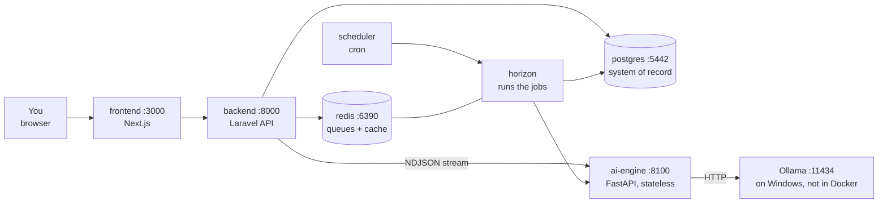

# Getting Started

Everything needed to run this project from nothing, and to explain it to someone else. For what is
running once it has started and what each process spends its time on, see
[how-it-works.md](how-it-works.md); for day-to-day commands, the [runbook](runbook.md); for *why* it
is built this way, the [design package](00-README.md).

---

## 1. What this is, in plain terms

You screenshot a stock chart. The app reads it, analyses it, and gives you a structured report — a
decision (BUY / WAIT / HOLD / SELL / AVOID), an entry, a stop, targets, and the reasoning — where
**every number traces back to a piece of evidence**. It then remembers what it said, checks it
against what the market actually did, and shows you its own hit rate.

Two things make it unusual, and they are worth saying out loud to anyone you explain it to:

- **The AI never produces numbers.** Language models are good at describing a chart and bad at
  reading exact prices off one; they invent levels confidently. So every price, indicator and
  percentage is computed by ordinary deterministic code and stored as an evidence record. The model
  only writes the prose, and a guardrail rejects any sentence containing a number that is not in the
  evidence.
- **It keeps score against itself.** Every analysis emits machine-checkable predictions. A job runs
  after the market closes and marks them against real price bars. That is where the hit rates,
  the R-multiples and the calibrated probabilities on the Performance page come from — nothing on
  that page is an estimate.

It runs entirely on your own machine. No paid APIs, no data leaving the laptop. NEPSE (Nepal Stock
Exchange) first.

---

## 2. The moving parts

Seven processes. Five are containers you never think about; two need a word of explanation.



| Process | What it does | Why you'd care |
|---|---|---|
| `frontend` | The web app you actually use | Port 3000 — this is the URL you open |
| `backend` | REST API, authentication, **owns the database** | The system of record. Every fact lives here |
| `horizon` | Runs the queued jobs — chart analysis, the market-data scraper, the market scan, outcome scoring | If analyses stay stuck at "queued", this is down |
| `scheduler` | Fires timed jobs — the 17:00 Kathmandu scrape, then prediction scoring, then the market scan | Silent. It's why today's bars, scores and scanner rows appear on their own |
| `ai-engine` | The analysis itself: indicators, patterns, scoring, the report | **Stateless** — no database, no memory. Data in, analysis out |
| `postgres` | The database | Lives in a Docker volume; survives `down`, dies on `down -v` |
| `redis` | Queue backend and cache | Same |
| **Ollama** | The local LLMs, on your GPU | **Not a container.** Runs natively on Windows so it can reach the GPU |

Two consequences worth remembering:

- **Ollama runs outside Docker.** The containers reach it at `host.docker.internal:11434`. If
  Ollama isn't started, the app still works for everything except the narrative text: the report
  falls back to a template built from the same verified numbers, and says so.
- **The engine is stateless on purpose.** It has no database. That means it can be moved to a
  separate GPU machine later without redesigning anything, and it means the engine can never be the
  reason a number is wrong twice.

---

## 3. Prerequisites

| Need | Why | Check it |
|---|---|---|
| **Docker Desktop** on the WSL2 backend | Runs everything except Ollama. Laravel's Horizon needs `pcntl`, which is why this is not optional on Windows | `docker ps` answers |
| **Ollama for Windows** | The local models, natively, for GPU access | `curl http://localhost:11434/api/tags` answers |
| **Python 3.12** (`py` launcher) | Only for the helper scripts in `infra/scripts/` | `py --version` |
| An NVIDIA GPU | Optional but assumed. 4 GB is enough — that is the `gpu_4gb` profile | `nvidia-smi` |

Host PHP, Node and `uv` are optional. Every check and command in this project can run inside the
containers.

---

## 4. First run, from nothing

Four commands. Run them from the repository root in PowerShell.

```powershell
# 1. Generate the .env files and all the secrets in them.
py infra/scripts/init_env.py

# 2. Build and start the seven services. First run pulls images and builds — expect several minutes.
docker compose up -d --build

# 3. Create the database tables and the owner account.
docker compose exec backend php artisan migrate --seed

# 4. Read your login out of .env (it was generated in step 1).
Get-Content .env | Select-String "OWNER_"
```

Open <http://localhost:3000> and sign in with that email and password.

Then the models, which are a separate download (a few GB) and can run while you look around:

```powershell
ollama pull qwen2.5vl:3b     # vision — reads the ticker off the screenshot
ollama pull qwen3:4b         # text — writes the narrative
```

Until the vision model is pulled, every report carries a warning that the screenshot was never
checked against the symbol you chose — the analysis is still correct, but nothing verified that the
chart is the company it was run for. See [forecast.md](forecast.md) and
[04 §5.1](04-ai-agent-workflow.md#51-vision-agent).

### Did it work?

```powershell
docker compose ps                                    # seven services, all healthy
curl http://localhost:8000/api/v1/health             # database, Redis, engine and Ollama
```

The app header shows the same health status, so you can also just look at the page. If Ollama shows
as down, everything else still works — you get the deterministic report without the LLM prose.

### Before it can analyse anything

The app needs real price bars. It fetches them itself — see [section 5](#5-market-data-the-scraper)
— and the short version is three commands:

```powershell
docker compose exec backend php artisan market:import-merolagani-symbols   # ~580 NEPSE securities
docker compose exec backend php artisan market:sync-merolagani --queue     # their price history
docker compose exec backend php artisan market:scan --queue                # read the whole market
```

Without bars an analysis drops to a lower data tier and honestly refuses to give you entry and stop
numbers. That is deliberate, not a bug.

---

## 5. Market data: the scraper

The app fetches NEPSE prices itself. Nothing here needs an API key, a login or a paid feed.

Two sources, and they do different jobs. **Merolagani is primary** — it hands over a symbol's whole
history in one request, bonus-adjusted. **Sharesansar fills its gaps** — the debentures and promoter
shares merolagani does not chart, plus the traded amount it has no field for. Full reasoning in
[market-data.md](market-data.md); this section is the commands.

> Every command below is run from the repository root. `docker compose exec backend` is how you
> reach Laravel's console inside the container.

### 5.1 First time: get the symbols

The seeder ships a 22-row starter list, so most symbols — PCBL included — do not exist yet. This
creates the rest from merolagani's own listing:

```powershell
# See what it would create, without writing anything
docker compose exec backend php artisan market:import-merolagani-symbols --dry-run

# Actually create them
docker compose exec backend php artisan market:import-merolagani-symbols
```

**Expect:** `582 securities listed, 22 already known, 560 new.` Takes a few seconds — it is one
request.

It only ever **adds**. An existing row keeps its name, sector and instrument type, and nothing is
deactivated or deleted: a delisting is a decision, not an import. Instrument type is guessed from
the company name (bond/debenture → `debenture`, fund/scheme/yojana/kosh → `mutual_fund`, otherwise
`equity`). Sectors are filled in by the first sync.

### 5.2 First time: get the price history

```powershell
# Everything, in the background, spread out politely. This is the one you want.
docker compose exec backend php artisan market:sync-merolagani --queue
```

**Expect:** about **75 minutes** for ~580 symbols and roughly **510,000 bars**. It runs on the
`market-data` queue, two seconds apart per symbol, so you can keep using the app. Watch it at
<http://localhost:8000/horizon> or:

```powershell
docker compose exec postgres psql -U stock_ai -d stock_ai -c "SELECT count(DISTINCT stock_id) AS stocks, count(*) AS bars FROM price_bars;"
```

Smaller, foreground variants when you want to see the output:

```powershell
# One symbol, printed as a table. Good for checking it works. ~8 seconds, ~3,500 bars.
docker compose exec backend php artisan market:sync-merolagani PCBL

# A few symbols
docker compose exec backend php artisan market:sync-merolagani PCBL NABIL UPPER

# Every active stock, in the foreground (slow, but you see each one)
docker compose exec backend php artisan market:sync-merolagani

# Re-fetch entire histories rather than just recent days
docker compose exec backend php artisan market:sync-merolagani --backfill
```

| Flag | What it does |
|---|---|
| *(none)* | Every **active** NEPSE stock |
| `SYMBOL…` | Only those symbols |
| `--queue` | Dispatch to the queue instead of running here |
| `--backfill` | Ask for the whole history, not just the recent window |
| `--spacing=N` | Seconds between symbols on a queued run (default 2) |

**You do not need `--backfill` for a first run.** A stock with no bars is backfilled automatically;
the flag is for re-fetching a history you already have.

### 5.3 Filling merolagani's gaps

About a hundred NEPSE securities — debentures, government savings bonds, promoter shares — return
`no_data` from merolagani. Sharesansar has roughly a third of them:

```powershell
docker compose exec backend php artisan market:sync-sharesansar --missing --backfill
```

**Expect:** `33 symbols imported (3301 new bars), 64 had nothing to give, 0 failed.` A few minutes.
Nineteen of those stocks cross the 60-bar threshold and become analysable.

The 64 that gave nothing have never traded on the secondary market. That is the ceiling, not a bug.

```powershell
# Named symbols instead
docker compose exec backend php artisan market:sync-sharesansar GSY SDBD87 --backfill

# Stop after N symbols — useful for a first cautious look
docker compose exec backend php artisan market:sync-sharesansar --missing --limit=5
```

**A symbol that already holds merolagani bars is refused** unless you pass `--force`, and you almost
certainly should not: merolagani is bonus-adjusted and sharesansar is raw, so splicing them puts two
price scales in one series and every indicator drawn across the join reads a gap that never happened.

### 5.4 Read the market

Once bars are in, the engine reads every stock — structure, traps, opportunities, base rates:

```powershell
# Everything, in the background
docker compose exec backend php artisan market:scan --queue

# Everything, foreground, with a ranked table at the end (~4 minutes)
docker compose exec backend php artisan market:scan

# Named symbols
docker compose exec backend php artisan market:scan PCBL NABIL

# A different style profile
docker compose exec backend php artisan market:scan --style=positional
```

**Expect:** around **90 ms per stock**, so ~400 stocks in under a minute of engine time. Results
appear on the **Scanner** page at <http://localhost:3000/scanner>. Details in
[scanner.md](scanner.md).

### 5.5 After the first run it does this itself

The `scheduler` service runs it. You do not need to do anything daily.

| When (Asia/Kathmandu) | What happens |
|---|---|
| **17:00 every day** | Fetch the day's bars for every active stock — two hours after the 15:00 NEPSE close |
| when that finishes | Score every open prediction against the new bars |
| when that finishes | Re-scan the whole market |
| 16:00 Mon–Fri | Prediction scoring again, as a safety net for a day whose sync never ran |
| every 5 minutes | Watchdog for analyses whose worker died |

Each run re-asks for the last ten days as well as today, so a late or corrected bar is picked up by
the next run and a few missed days need no intervention. Everything is idempotent: re-running is
always safe.

```powershell
docker compose exec backend php artisan schedule:list    # what is registered, and when it next fires
```

If the machine was off at 17:00, just run the sync by hand — it will catch up on its own.

### 5.6 CSV import, still there

For anything the scrapers do not cover — another exchange, a corrected history, intraday bars — the
**Market data** page takes OHLCV CSV files. Formats in [csv-format.md](csv-format.md).

A CSV and a scraper can share a symbol safely: a provider overwrites what it measured and leaves
alone what it never saw, so merolagani (which has no traded amount) will not wipe a turnover your
CSV supplied.

### 5.7 Checking what you have

```powershell
# Coverage at a glance
docker compose exec postgres psql -U stock_ai -d stock_ai -c "SELECT source, count(*) AS bars, count(DISTINCT stock_id) AS stocks FROM price_bars GROUP BY source;"

# Stocks still with no data anywhere
docker compose exec postgres psql -U stock_ai -d stock_ai -c "SELECT count(*) FROM stocks s LEFT JOIN (SELECT DISTINCT stock_id FROM price_bars) b ON b.stock_id = s.id WHERE b.stock_id IS NULL;"

# One symbol's latest bars
docker compose exec postgres psql -U stock_ai -d stock_ai -c "SELECT bar_time::date, open, high, low, close, volume, turnover, source FROM price_bars b JOIN stocks s ON s.id = b.stock_id WHERE s.symbol = 'PCBL' ORDER BY bar_time DESC LIMIT 5;"
```

A healthy full import looks like ~518 stocks with bars, ~515,000 bars, and ~64 securities that have
never traded.

### 5.8 Narrowing what gets synced

Syncing all ~580 symbols nightly is fine, but if you only care about a handful, deactivate the rest
— the scheduled run only touches **active** stocks:

```powershell
docker compose exec backend php artisan tinker --execute="App\Domain\Market\Models\Stock::whereNotIn('symbol',['PCBL','NABIL','NEPSE'])->update(['is_active'=>false]);"
```

Reactivate the same way with `true`. Deactivating does not delete any bars.

### 5.9 When the scraper misbehaves

| Symptom | What it means |
|---|---|
| `None of those symbols are NEPSE stocks` | The stock does not exist yet — run `market:import-merolagani-symbols` |
| `Merolagani price history returned HTTP 5xx` | Their site is down. The job retries twice (30 s, 120 s), then the next daily run picks it up |
| Bars stop arriving, no errors | Check `docker compose exec backend php artisan horizon:status`; Horizon needs a restart after any config change |
| A symbol reports `0 new, 0 updated` | `no_data` for that range — normal for a delisted or newly listed security |
| `Sharesansar session could not be established` | Their CSRF token or page layout moved. The price sync is unaffected |
| Some bars are skipped with a reason | About 0.3% of vendor bars are impossible candles (low above the open). They are reported, never silently dropped |

Nothing is ever dropped quietly. Every skipped bar is printed with its reason and logged under
`merolagani.sync.symbol`.

```powershell
docker compose logs -f horizon | Select-String "merolagani|scan"
```

---

## 6. Every day

```powershell
docker compose up -d       # start
docker compose ps          # is everything healthy?
docker compose stop        # stop, keep the data
```

With the stack up, the day runs itself: the scraper fetches bars at 17:00 Kathmandu, open
predictions get scored, and the scanner re-reads the market — see
[section 5.5](#55-after-the-first-run-it-does-this-itself). You only touch the market-data commands
for the first import, or to catch up after the machine was off.

| URL | What |
|---|---|
| <http://localhost:3000> | **The app** |
| <http://localhost:3000/scanner> | The market scan — every stock, ranked, with its traps and openings |
| <http://localhost:3000/forecast> | One stock's next day and next week, measured, by kind of analysis |
| <http://localhost:8000/api/v1/health> | Health of the database, Redis, engine and Ollama |
| <http://localhost:8000/docs/api> | Generated API documentation |
| <http://localhost:8000/horizon> | Queue dashboard — what's running, what failed |
| <http://localhost:8100/health> | Engine health on its own |

Data survives `docker compose down`. It does **not** survive `docker compose down -v`, which deletes
the Postgres and Redis volumes. Your uploaded screenshots are separate: they live in `storage/` on
disk and are never in a volume.

---

## 7. Credentials

**All secrets live in two files, and neither is ever committed.** `.gitignore` excludes `.env` and
`.env.*`, so the values below exist only on your machine. This document deliberately does not
contain them — it tells you where they are and how to replace them.

```powershell
Get-Content .env              # shared: ports, database, engine secret, owner account
Get-Content backend/.env      # Laravel's own settings; the shared values are copied in here
```

| Credential | What it protects | Where | If you need a new one |
|---|---|---|---|
| `OWNER_EMAIL` / `OWNER_PASSWORD` | **Your login to the app** | `.env`, copied to `backend/.env` | Edit both, then `docker compose exec backend php artisan db:seed`. Minimum 12 characters |
| `POSTGRES_PASSWORD` | The database | `.env` → `DB_PASSWORD` in `backend/.env` | Changing it on an existing database means recreating the volume. Easiest path is `docker compose down -v` and starting over |
| `ENGINE_HMAC_SECRET` | Signs every Laravel → engine request | `.env`, used by both `backend` and `ai-engine` | `python -c "import secrets; print(secrets.token_hex(32))"`, put the **same** value in both files, then `docker compose up -d` |
| `APP_KEY` | Laravel's encryption and session keys | `backend/.env` only | `docker compose exec backend php artisan key:generate`. **Changing it logs you out and makes existing encrypted data unreadable** |
| Redis | — | — | No password locally; Redis is not published beyond the compose network plus your own machine |

`py infra/scripts/init_env.py` generates all of these on a fresh setup. It is **safe to re-run**: it
never overwrites a value that is already set, and it never prints a secret. Run it after pulling if
a new key was added to `.env.example`.

### The one that is not a local secret

`ENGINE_HMAC_SECRET` is shared between two services. If they disagree, every analysis fails with a
401 from the engine and nothing else looks wrong. If analyses start failing immediately after you
touch an `.env`, check that one first.

### Handing this to someone else

Give them the repository and let them run `init_env.py` — they get their own secrets and their own
owner account. Never copy your `.env` to another machine.

---

## 8. What each folder does

```
stock-ai-analyzer/
├── docs/          Design, plans, runbook. Read 00-README.md first
├── frontend/      The web app (Next.js) — what you look at
├── backend/       The API (Laravel) — owns the database, owns the truth
├── ai-engine/     The analysis (Python) — stateless, no database
├── contracts/     Generated OpenAPI document; the frontend's types come from it
├── infra/         Dockerfiles, Postgres init, helper scripts
└── storage/       Your uploaded screenshots and exported reports. Real data — not in git
```

### `backend/` — the system of record

```
app/Domain/          The business concepts, one folder each: Analysis, Chart, Identity,
                     Journal, Market, Prediction. Models, enums and pure domain services.
app/Application/     Things the app *does*: Actions, Jobs (AnalyzeChartJob,
                     EvaluatePredictionsJob), Services (stats, calibration, persistence).
app/Infrastructure/  Talking to the outside world: the engine client, storage, market data.
app/Presentation/    HTTP: controllers, requests, resources. Thin by design.
database/migrations/ The schema. This is the authority on what a column may contain —
                     it is stricter than it looks and will catch you.
routes/api_v1.php    Every endpoint, in one readable file.
tests/               Pest — feature tests against a real Postgres, unit tests for the
                     pure domain services.
```

The layering rule: `Presentation → Application → Domain`, and `Infrastructure` is reached only
through interfaces. A controller never touches the database directly.

### `ai-engine/` — the analysis

```
ai_engine/analysis/  The deterministic core: indicators (matched to TA-Lib to ~1e-14),
                     swings, levels, classic patterns, candlesticks, SMC, scoring, risk.
                     No AI in here at all.
ai_engine/agents/    The per-stage agents, including the analyst that writes the prose.
ai_engine/guardrails/  What every analyst draft must survive: no invented numbers, no
                     certainty, no contradicting the decision, no fake citations.
ai_engine/prompts/   The analyst and repair prompts, versioned.
ai_engine/pipeline/  The orchestrator that runs the stages and streams progress.
ai_engine/api/       The FastAPI surface. POST /v1/analyze does the work; the rest is
                     /health, /livez and /v1/models.
ai_engine/reports/   Jinja templates for the written report.
config/              YAML: scoring weights, model profiles, indicator parameters.
                     Tuning happens here, not in code.
contracts/           JSON Schemas the backend validates against — the shared contract.
tests/               pytest, with a coverage floor of 90% on analysis/ and agents/.
```

### `frontend/` — the app

```
src/app/         Routes (Next.js App Router). One folder per page.
src/features/    The real code, grouped by feature: analysis, auth, journal, market,
                 settings, stats, upload, health.
src/components/  Shared UI (shadcn/ui primitives).
src/lib/api/     The API client and schema.d.ts — generated from contracts/openapi.json.
                 Never hand-edit schema.d.ts.
```

### `docs/` — read in this order

| File | What it answers |
|---|---|
| [00-README.md](00-README.md) | The six decisions that shape everything. **Start here** |
| [01-PRD.md](01-PRD.md) | What we build, and what we refuse to build |
| [02-architecture.md](02-architecture.md) | Components, layering, the architectural decisions |
| [03-database-schema.md](03-database-schema.md) | Every table and column |
| [04-ai-agent-workflow.md](04-ai-agent-workflow.md) | The pipeline, scoring, the decision policy, the learning loop |
| [05-api-spec.md](05-api-spec.md) | Every endpoint, request and response |
| [planning/](planning/README.md) | The build plan, phase by phase, with live checkboxes |
| [market-data.md](market-data.md) | Where NEPSE prices come from, and why two sources |
| [scanner.md](scanner.md) | The market scan: traps, openings, and base rates |
| [forecast.md](forecast.md) | Next day and next week, measured rather than predicted, by kind of analysis |
| [analyst.md](analyst.md) | How an LLM is allowed near a product where every number must trace to evidence |
| [csv-format.md](csv-format.md) | The CSV import format |
| [how-it-works.md](how-it-works.md) | Starting it, what each process does, the scraper and the nightly cycle, end to end |
| [runbook.md](runbook.md) | Day-to-day operations and troubleshooting |

---

## 9. "I want to change…"

| …this | Go here | Then |
|---|---|---|
| How much each factor counts toward the score | `ai-engine/config/scoring.yaml` | Restart `ai-engine`. **This bumps the engine version**, which resets calibration for new analyses — on purpose |
| Which models are used | `ai-engine/config/models.yaml`, `MODEL_PROFILE` in `.env` | `docker compose up -d ai-engine` |
| The list of tradeable symbols | Nothing — run `market:import-merolagani-symbols` | It pulls all ~580 from the exchange listing. The seeder CSV is only a starter list |
| Which stocks get synced and scanned nightly | `stocks.is_active` | See [section 5.8](#58-narrowing-what-gets-synced) |
| Where price data comes from, or how far back | `MEROLAGANI_*` in `backend/.env` | `docker compose restart backend horizon scheduler` |
| Whether the LLM writes the narrative | `ANALYST_ENABLED` for the engine | `docker compose restart ai-engine`. Off means every report is the template |
| A database column | A new file in `backend/database/migrations/` | `docker compose exec backend php artisan migrate` |
| An API endpoint | `backend/routes/api_v1.php` + a controller | Regenerate the contract so the frontend's types follow |
| Anything in `backend/.env` | That file | `docker compose restart backend horizon scheduler` — the API runs with `--no-reload` and will not notice otherwise |

### Running the checks

```powershell
powershell -ExecutionPolicy Bypass -File infra/scripts/check.ps1
```

Pint, PHPStan level 8, Pest, ruff, mypy strict, pytest, ESLint, tsc and Vitest — all inside the
containers, so it needs nothing installed on the host. Add `-Only backend|engine|frontend` to narrow
it down.

### Regenerating the API contract

The frontend's TypeScript types are generated from the backend's routes. After changing an endpoint:

```powershell
docker compose exec backend php artisan scramble:export --path=/var/www/contracts/openapi.json
docker compose exec frontend npx openapi-typescript ../contracts/openapi.json -o src/lib/api/schema.d.ts
```

---

## 10. When something breaks

The [runbook](runbook.md) has a troubleshooting table. The three that catch people first:

| Symptom | Cause |
|---|---|
| Analyses sit at "queued" forever | `horizon` is down. `docker compose ps`, then check <http://localhost:8000/horizon> |
| Health says Ollama isn't running | Ollama is a Windows app, not a container. Start it from the Start menu |
| A frontend change doesn't appear | Next.js sometimes serves a stale chunk. `docker compose restart frontend`. New route folders always need this |
| The Scanner page is empty | No scan has run. `market:scan --queue`, and check there are price bars first |
| A backend code change has no effect on a queued job | Horizon workers hold the old code in memory. `docker compose restart horizon` |
| Reports say `narrative_source: template` | The analyst was unreachable or its draft failed the guardrails. The analysis is fine; see [analyst.md](analyst.md) |

Logs are one command away:

```powershell
docker compose logs -f backend horizon      # Laravel, JSON lines with request ids
docker compose logs -f ai-engine            # the engine, structlog JSON
```
