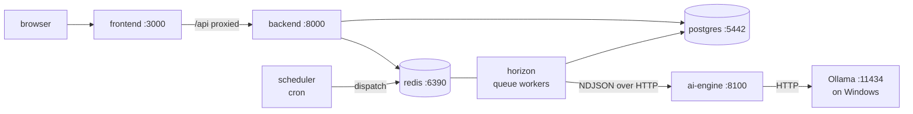

# How it works: starting, running, and what happens in between

The operator's manual. What to type to start the thing, what is running once it has started, what
each process does with its time, and how the scraper actually gets NEPSE prices onto your disk.

Everything here is copy-pasteable PowerShell, run from the repository root.

| If you want | Read |
|---|---|
| To run it for the first time, with explanations | [getting-started.md](getting-started.md) |
| **To understand what is running and why** | **this file** |
| A command, fast, without prose | [runbook.md](runbook.md) |
| The scraper in full detail | [market-data.md](market-data.md) |
| Why it is designed this way | [00-README.md](00-README.md) |

---

## 1. Start it

### Cold start — a machine that has never run this

```powershell
py infra/scripts/init_env.py            # 1. write .env and backend/.env, generate the secrets
docker compose up -d --build            # 2. build and start 7 containers (minutes, first time only)
docker compose exec backend php artisan migrate --seed   # 3. create the tables and your account
Get-Content .env | Select-String "OWNER_"                # 4. read your login out of .env
```

Open <http://localhost:3000> and sign in.

Then the two models — a few GB, downloads in the background while you look around:

```powershell
ollama pull qwen2.5vl:3b     # vision: reads the ticker off your screenshot
ollama pull qwen3:4b         # text: writes the report's prose
```

Then the data, because without price bars the app can only refuse to give you numbers:

```powershell
docker compose exec backend php artisan market:import-merolagani-symbols   # ~580 securities, seconds
docker compose exec backend php artisan market:sync-merolagani --queue     # their history, ~75 min, ~510k bars
docker compose exec backend php artisan market:scan --queue                # read the market (see §3c on timing)
```

Watch the last two at <http://localhost:8000/horizon>. They are queued jobs, not your terminal's
problem — you can close the window.

### Every start after that

```powershell
docker compose up -d
```

That is all. Data, models and settings survive. If you pulled new code, add the two steps that
apply to new code rather than new machines:

```powershell
docker compose up -d --build                      # only if a Dockerfile or dependency changed
docker compose exec backend php artisan migrate   # only if there are new migrations
```

> Behind on migrations right now? Two landed recently: `chart_uploads.symbol_confirmed` and
> `market_scans.outlook`. Run `migrate`, then re-run `market:scan --queue` so the Forecast page has
> something to show.

### Did it work?

```powershell
docker compose ps                            # 7 services, all "healthy" or "running"
curl http://localhost:8000/api/v1/health     # database, redis, engine — and what the engine says about Ollama
```

The app header shows the same health status, so you can just look at the page. **Ollama down is not
fatal**: you still get the full deterministic report, with a warning that the narrative is the
template and the chart's symbol was not verified.

### Stopping

```powershell
docker compose stop      # stop, keep everything
docker compose down      # remove containers, keep the database and Redis volumes
docker compose down -v   # also delete the database, Redis and frontend caches — a real reset
```

---

## 2. What is running

Seven containers plus Ollama, which is not a container.



| Process | Its job | You notice it is down when |
|---|---|---|
| `frontend` | The Next.js app. Also **proxies** `/api` and `/sanctum` to the backend so cookies stay first-party | localhost:3000 does not load |
| `backend` | Laravel API, auth, and **the only writer to the database** | Everything 500s or the page says it cannot reach the API |
| `horizon` | Runs every queued job: analyses, the scraper, the market scan, outcome scoring | Analyses sit at "queued" forever; no new bars |
| `scheduler` | `schedule:work`. Fires the timed jobs — nothing else | Today's bars, scores and scanner rows never appear on their own |
| `ai-engine` | The analysis itself. FastAPI, **stateless**, no database | Analyses fail with `ENGINE_UNAVAILABLE` |
| `postgres` | The system of record | Health shows the database down |
| `redis` | Queue backend and cache | Health shows Redis down; jobs stop moving |
| **Ollama** | The local models on your GPU. **Runs natively on Windows**, reached at `host.docker.internal:11434` | Reports say `narrative_source: template` and carry a "not checked against the symbol" warning |

Useful addresses:

| URL | What |
|---|---|
| <http://localhost:3000> | The app |
| <http://localhost:8000/horizon> | Queue dashboard — jobs, failures, retries |
| <http://localhost:8000/api/v1/health> | Database, Redis, engine, models |
| <http://localhost:8000/docs/api> | API reference |
| <http://localhost:8100/health> | Engine health, on its own |

Two design facts worth carrying in your head:

- **The engine has no database.** It is given everything it needs in one request and answers with
  one result. That is why it can never be the reason a stored number is wrong twice, and why it
  could move to a separate GPU box without redesigning anything.
- **The backend never analyses anything itself.** It stores, queues, and maps results into rows.

---

## 3. What happens, step by step

### 3a. You analyse a chart

```
browser → backend → redis → horizon → ai-engine → ollama → back to postgres → browser
```

1. **Upload.** `POST /api/v1/charts/upload`. `ChartStorage` sniffs the type from the bytes, checks
   the dimensions from the header, re-encodes to PNG (which strips EXIF and anything appended to
   the file), hashes it, and writes it to `storage/charts/{user}/{yyyy}/{mm}/{ulid}.png`. The hash
   deduplicates per user: the same image twice returns the first row.
2. **Request.** `POST /api/v1/charts/{id}/analyze` → `RequestAnalysis`. It attaches the ticker if
   you supplied one, counts the price bars available, reuses an identical completed run if there is
   one, otherwise writes an `analyses` row with status `queued` and dispatches `AnalyzeChartJob`
   onto the **`ai` queue**.
3. **Worker.** Horizon picks it up — one at a time, because one GPU runs one model well.
   `EngineRequestBuilder` assembles the payload: your account settings, the exchange's fees and lot
   size, up to 600 bars, the image path, the symbol and company name, and the exchange's whole
   symbol list.
4. **Engine.** `PythonEngineClient` POSTs it to `/v1/analyze` signed with HMAC-SHA256 over
   `timestamp + "." + body`; a signature more than 300 seconds old is rejected. The engine answers
   with a stream of NDJSON lines rather than one response:

   ```
   {"event":"accepted", ...}
   {"event":"stage","stage":"indicators","progress":0.2, ...}
   {"event":"heartbeat", ...}          ← the analyst can hold the GPU for minutes
   {"event":"result","data":{ ... }}
   ```

5. **Inside the engine**, in this order:

   | Stage | What it does |
   |---|---|
   | `identity` | The vision model reads the chart's title and the run is refused if the screenshot is of a different company — see [§5.1](04-ai-agent-workflow.md#51-vision-agent). Skipped if `image_path` is null or the check is off |
   | — | Picks the data tier: A (enough OHLCV) or C (vision only) |
   | `indicators` | EMAs, RSI, MACD, ATR, volume — pure NumPy |
   | `structure` | Swings, then support/resistance levels |
   | `technical` `smc` `patterns` | The three reading agents |
   | `base_rates` | What each firing signal was worth before, on this symbol — plus the next-day and next-week move distributions behind the [Forecast page](forecast.md) |
   | `scoring` | Nine weighted factors → bias and a 0-100 setup **rank** |
   | `risk` | Entries, stops, targets, position size, then the decision policy |
   | `analyst` | The LLM writes the prose. **Guardrails reject any number not in the evidence**; one repair attempt, then the template |
   | `report` | Markdown assembled from the structured result |

6. **Persist.** `PersistAnalysisResult` maps the result into `analyses`, `analysis_indicators`,
   `analysis_patterns`, `analysis_levels` and `predictions`. Anything the mapper does not recognise
   is dropped rather than guessed at.
7. **The browser** has been polling `/analysis/{id}/status` the whole time and switches to the
   report when the status turns terminal.

**If it fails**, it fails into a row: every path ends with a status and an error code the UI can
explain — never stuck at `running`. A watchdog sweeps every five minutes for analyses whose worker
died.

### 3b. The nightly cycle (this is the one that runs itself)

NEPSE closes at 15:00 Kathmandu. Merolagani publishes the day's bar in the hours after that.

| Time (Asia/Kathmandu) | What fires | Queue |
|---|---|---|
| every 5 min | `StuckAnalysisWatchdog` — fails analyses whose worker died | `default` |
| 16:00, Mon-Fri | `EvaluatePredictionsJob` — safety net, in case no sync ran today | `evaluation` |
| **17:00, daily** | `SyncMerolaganiPricesJob` — **the scrape** | `market-data` |

The 17:00 job is a fan-out, and what happens *after* it is the point:

```
SyncMerolaganiPricesJob
  └── Bus::batch: one SyncMerolaganiStockJob per stock, each delayed 2s further than the last
        └── when the whole batch finishes:
              ├── EvaluatePredictionsJob   → scores open predictions against the bars that just landed
              └── ScanMarketJob            → re-reads every stock with the engine
```

Chained rather than scheduled an hour later, so the scan can never run on stale data and the
scoring never waits until tomorrow. `allowFailures()` means one unreachable symbol cannot cancel
the two jobs that follow.

It runs seven days a week on purpose: the trading week is Monday-Friday *now*, but it has changed
before, and a day with no new bar costs one request that imports nothing.

### 3c. You read the market

The Scanner and Forecast pages do **not** run the engine. They read `market_scans`, filed by the
nightly `ScanMarketJob`, which sends the engine up to 2,000 bars per stock — the base rates and the
forecast distributions are measured over the *whole* history, and doing that per page view would
spend an engine call to reproduce an answer already on disk.

So: a stock with no scan has no scanner row and no forecast. Give it bars, then `market:scan`.

> **Timing, honestly.** The deterministic pipeline is ~90 ms per stock. But a scan goes through the
> same `/v1/analyze` endpoint as a chart analysis, so if `ENGINE_ANALYST_ENABLED` is on (the
> default) the text model also writes a narrative for every stock it reads, and *that* dominates
> the wall clock. If a full scan is taking far longer than the few minutes the other docs quote,
> this is why: set `ENGINE_ANALYST_ENABLED=false` on the `ai-engine` service before a full scan,
> and back afterwards.

---

## 4. The scraper, in detail

Full version in [market-data.md](market-data.md). This is the working model.

### What it talks to

Merolagani renders its price table only after an ASP.NET `__VIEWSTATE` postback, so nothing here
parses HTML tables. The same site feeds its own charts from three unauthenticated JSON handlers —
no session, no cookie, no token:

| Endpoint | Gives |
|---|---|
| `technicalcharthandler.ashx?type=get_advanced_chart` | Daily OHLCV, **the whole history in one request** |
| `webrequesthandler.ashx?type=get_company_summary` | Last price, 52-week range, EPS, P/E, market cap, dividends |
| `technicalcharthandler.ashx?type=get_symbols_by_search` | Every listed security (582 today) |

The rendered page is fetched for one thing only — sector, shares outstanding, book value — and only
for a stock that still has no sector. One page per stock *ever*, not per day.

**Daily bars only.** The handler answers other resolutions with raw trade prints that TradingView
aggregates in the browser. Asking for `1h` would mean inventing bars, so the provider refuses any
timeframe but `1D`.

### First run vs every run after

There is no separate "first-time" mode to remember. A stock with no bars gets its whole history;
one that already has bars gets a short recent window, and every run re-asks for the last few days
so a restated bar is corrected rather than lost.

The write is an upsert on `(stock_id, timeframe, bar_time)`. **Re-running is always safe** — it is
the same operation, not a duplicate.

### Being a polite guest

Merolagani is somebody else's server. One request at a time (the `market-data` queue runs a single
process), symbols spaced two seconds apart (`--spacing`), and the whole batch is one courtesy call
a day.

### What it refuses to import

Nothing is dropped silently — every skip is printed and logged with its reason.

- **Duplicate dates.** A few dates are listed twice; the first wins.
- **Impossible candles.** ~0.3% of bars have a low above the open, or a high below it. The database
  has a CHECK constraint for exactly that shape, so such a bar could not be stored anyway.
- **Duplicate symbols.** `HURJA` is listed twice, once with an empty name; the named one wins.

### Two subtleties that will bite you if you forget them

**Dates are UTC, deliberately.** The vendor's timestamps carry the right calendar date in UTC and
an unreliable time of day — older bars at 05:45 UTC, recent ones around 20:45 UTC, which is 02:30
*the next morning* in Kathmandu. Reading them in local time shifts every recent bar forward a day.
The UTC date is the business date, stored at 00:00 UTC.

**Prices are adjusted by default.** `MEROLAGANI_ADJUSTED=true` asks for the bonus- and
rights-adjusted series, because NEPSE companies issue bonus shares often and in a raw history each
one is a huge overnight gap no indicator can distinguish from a real move. The adjusted series
starts later than the raw one. If you ever switch this off, re-run with `--backfill` — the two
series are on different price scales and mixing them within one symbol is meaningless.

### Sharesansar, the second source

Merolagani does not chart about a hundred NEPSE securities — debentures, savings bonds, promoter
shares — and its chart handler has volume but no turnover. Sharesansar covers roughly a third of
the first gap and all of the second.

It is a harder scrape: a DataTables POST behind CSRF, so the client lifts a `_token` and its bound
session cookie from one ordinary page load and reuses both; the endpoint keys on a numeric company
id, not the symbol (passing `NABIL` returns zero rows rather than an error), so the id is looked up
once and cached on the stock; and pages are capped at 50 rows server-side — asking for more returns
HTTP 202 and an empty body. A long history is therefore dozens of requests, which is precisely why
it is not the primary source.

**The two are never spliced within one symbol.** Adjusted and unadjusted prices on one chart would
be a lie with a line through it. `--force` exists and you should not use it.

### Running it by hand

```powershell
# Symbols — once, before anything else. The shipped seed list is only 22 rows.
docker compose exec backend php artisan market:import-merolagani-symbols --dry-run
docker compose exec backend php artisan market:import-merolagani-symbols

# Prices
docker compose exec backend php artisan market:sync-merolagani                # every active stock, foreground
docker compose exec backend php artisan market:sync-merolagani PCBL NABIL     # named symbols, prints a table
docker compose exec backend php artisan market:sync-merolagani --queue        # what the scheduler does
docker compose exec backend php artisan market:sync-merolagani --backfill     # re-ask for full histories

# The gaps merolagani cannot fill
docker compose exec backend php artisan market:sync-sharesansar --missing --backfill
docker compose exec backend php artisan market:sync-sharesansar GSY SDBD87 --backfill
docker compose exec backend php artisan market:sync-sharesansar --missing --limit=5  # a cautious first look

# Read the market with the engine
docker compose exec backend php artisan market:scan --queue                   # all, backgrounded
docker compose exec backend php artisan market:scan PCBL                      # one, with a table
docker compose exec backend php artisan market:scan --style=positional
```

Foreground prints a table and is what you want when watching a first backfill. `--queue` dispatches
the same jobs the scheduler does and returns immediately.

For anything neither source covers — another exchange, a corrected history, intraday bars — import
OHLCV CSVs on the **Market data** page ([csv-format.md](csv-format.md)). Same validation, same
upsert, same table.

---

## 5. The queues

Four of them, each isolated for a reason. Watch all of it at <http://localhost:8000/horizon>.

| Queue | Carries | Processes | Why separate |
|---|---|---|---|
| `ai` | `AnalyzeChartJob` | **1**, 900 s timeout | One GPU runs one model well. Two at once is slower than one after the other |
| `market-data` | The sync batch, `ScanMarketJob`, `ScanStockJob` | 1, 3 tries, low priority | A full backfill is a long line of network calls that must not delay your analysis |
| `evaluation` | `EvaluatePredictionsJob` | 1 | Scoring is cheap but must not queue behind a backfill |
| `default` | The watchdog | 2 | Everything else |

```powershell
docker compose exec backend php artisan horizon:status
docker compose exec backend php artisan queue:failed
docker compose exec backend php artisan queue:retry all
```

---

## 6. Where everything lives

| Thing | Where | Survives `down` | Survives `down -v` |
|---|---|---|---|
| Database | Docker volume `pgdata` | yes | **no** |
| Queues, cache | Docker volume `redisdata` | yes | **no** |
| Chart screenshots | `storage/charts/` on your disk | yes | yes |
| Generated reports | `storage/reports/` | yes | yes |
| Secrets | `.env`, `backend/.env` | yes | yes |
| Models | Ollama's own store, outside Docker | yes | yes |

The tables you will actually look at:

| Table | Holds |
|---|---|
| `stocks`, `exchanges` | The universe, lot sizes, fee schedules, trading days |
| `price_bars` | Every OHLCV bar. Unique on `(stock_id, timeframe, bar_time)` |
| `chart_uploads` | One row per screenshot, deduplicated per user by SHA-256 |
| `analyses` (+ `analysis_*`) | What the engine said, and every number it said it with |
| `predictions`, `outcomes` | Falsifiable claims, and how they actually resolved |
| `market_scans` | One engine read per stock per trading day — what the Scanner and Forecast pages read |

```powershell
docker compose exec postgres psql -U stock_ai stock_ai      # SQL shell
```

---

## 7. Your routine

**It does this on its own:** fetches the day's bars at 17:00, scores every open prediction against
them, re-reads all ~580 stocks with the engine, and refreshes the Scanner and Forecast pages.

**You do this:** open <http://localhost:3000>, look at the Scanner for what moved, the Forecast page
for what a name's next day and week have historically looked like, upload a screenshot when you want
the full treatment, and check Performance for whether the app has actually been right.

**Worth a weekly glance:** the Horizon dashboard for failed jobs, and the Market data page for
symbols still carrying no bars.

---

## 8. When it breaks

| Symptom | What it means | Fix |
|---|---|---|
| Analyses stay "queued" | Horizon is down or the `ai` queue is stuck | `docker compose ps`; `docker compose restart horizon` |
| `ENGINE_UNAVAILABLE` | The engine container is down or still booting | `docker compose ps ai-engine`; `docker compose logs -f ai-engine` |
| Every report says "the screenshot was not checked" | The vision model is not installed | `ollama pull qwen2.5vl:3b` |
| `narrative_source: template` | The text model was unreachable, or its draft failed the guardrails. **The analysis is fine** | `ollama list`; see [analyst.md](analyst.md) |
| `SYMBOL_MISMATCH` | The screenshot's title names a different company than the symbol you chose | Use the relink form on the error, or "analyse it anyway" if the model misread it |
| Report is Tier C with no entry or stop | Fewer than 60 bars for that symbol — a deliberate refusal, not a bug | Import price data, then re-run |
| Forecast page says "predates the forecast" | The scan was filed before `market_scans.outlook` existed | `php artisan migrate`, then `market:scan --queue` |
| No new bars today | Scheduler down, or merolagani unreachable | `docker compose logs scheduler`; run the sync by hand |
| Login returns 419 | Stale CSRF cookie | Clear cookies for localhost and reload |
| Health shows the database or Redis down | Container stopped | `docker compose restart postgres redis` |
| Frontend: module not found after a dependency change | The container has its own `node_modules` | `docker compose exec frontend npm install`, then restart it |
| Changed `backend/.env` and nothing happened | The API runs with `--no-reload` | `docker compose restart backend horizon scheduler` |

```powershell
docker compose logs -f backend horizon      # Laravel, JSON lines with request ids
docker compose logs -f ai-engine            # engine, structlog JSON
docker compose exec backend php artisan pail  # live Laravel tail
```

---

## 9. Changing things

| Change | Then |
|---|---|
| `.env` (ports, model profile, secrets) | `docker compose up -d` |
| `backend/.env` | `docker compose restart backend horizon scheduler` |
| PHP, Python or TypeScript source | Nothing — all three hot-reload |
| A Dockerfile or a dependency | `docker compose up -d --build` |
| `frontend/package.json` | `docker compose exec frontend npm install` then restart it |
| The model profile (`MODEL_PROFILE`) | `docker compose up -d ai-engine` |
| A Laravel API response shape | `cd frontend; npm run gen:api` — regenerates the OpenAPI document and the TS types |
| An engine Pydantic contract | `cd ai-engine; py -m uv run python scripts/export_schemas.py` |

Before committing anything:

```powershell
powershell -ExecutionPolicy Bypass -File infra/scripts/check.ps1
powershell -ExecutionPolicy Bypass -File infra/scripts/check.ps1 -Only engine   # or backend / frontend
```

Useful switches in `.env`:

| Setting | Does |
|---|---|
| `MODEL_PROFILE` | `gpu_4gb` / `gpu_8gb` / `gpu_16gb` / `cpu` — which models get loaded |
| `SYMBOL_CHECK_ENABLED` | `false` skips the vision check on the chart's ticker, saving one model load per analysis |
| `MEROLAGANI_ADJUSTED` | `false` fetches raw, unadjusted prices. Re-backfill after changing it |
