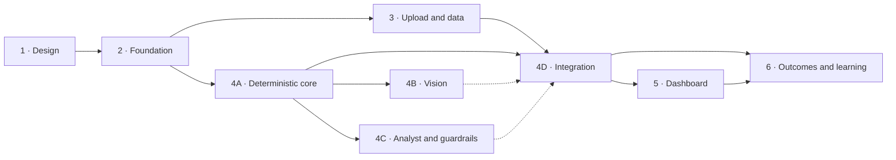

# Implementation Plan

The build is split into phases. Each phase has its own document with a goal, prerequisites, a checklist of tasks (with IDs and the files each creates), deliverables, an **exit gate**, and tests. A phase isn't done until its exit gate passes.

| Phase | Document | Goal | Effort* | Milestone |
|-------|----------|------|---------|-----------|
| 1 | [Design](phase-1-design.md) | PRD, architecture, schema, agents, API, plan | done | Approved 2026-09-12 |
| 2 | [Foundation](phase-2-foundation.md) | Environment, skeletons, schema, auth, Ollama benchmark | 5 d | **M1 · Walking skeleton** — built; Ollama installed, vision model and benchmark still open (P2-09 – P2-11) |
| 3 | [Chart upload and market data](phase-3-upload.md) | Screenshot intake, storage, CSV price import | 4 d | Built; exit gate needs real CSV exports and a browser check |
| 4A | [AI pipeline](phase-4-ai-pipeline.md#phase-4a--deterministic-analysis-core-tier-a) | Indicators, patterns, SMC, scoring, risk, policy; template report from CSV | 7 d | **M2 · Numbers you can trust** — built 2026-09-14; exit gate open on a real-CSV review |
| 4B | [AI pipeline](phase-4-ai-pipeline.md#phase-4b--vision-and-digitization) | OCR, axis calibration, candle digitizer, VLM | 7 d | **M3 · Reads your screenshot** |
| 4C | [AI pipeline](phase-4-ai-pipeline.md#phase-4c--analyst-agent-and-guardrails) | Analyst LLM, grounding guardrails, repair and fallback | 5 d | Built 2026-09-19, writing real reports ([analyst.md](../analyst.md)); Markdown rendering and the eval harness open |
| 4D | [AI pipeline](phase-4-ai-pipeline.md#phase-4d--integration) | Laravel ↔ engine, jobs, persistence, predictions | 4 d | **M4 · First real report in the app** — built 2026-09-14, Tier A path |
| 5 | [Dashboard and journal UI](phase-5-dashboard.md) | Report page, overlays, history, journal, settings | 7 d | **M5 · Usable daily** — core screens done 2026-09-14; overlays wait for 4B |
| 6 | [Outcomes, learning, hardening](phase-6-testing-learning.md) | Evaluator, stats, calibration, E2E, security, backups | 6 d | **M6 · Keeps score** — evaluation, stats and calibration done 2026-09-17; historical context, weight re-fit and hardening open |

\*Focused working days for one experienced developer; about 45 days for the MVP. Calendar time depends on your availability, and on how many golden-set screenshots you can label in 4B.

## Phase dependencies

Phase 3 and Phase 4A are independent and can run in parallel. 4B and 4C can also run in parallel.

**4D was built before 4B and 4C** (decided 2026-09-14). 4A already produces a complete
`AnalysisResult` with a template report, so integrating it unblocked Phases 5 and 6 in one phase
instead of three. Vision and the analyst then add fields the contract already carries.

**Why 4A comes before vision:** a Tier A report generated from real CSV data proves the analytical core and the evidence and grounding backbone *before* the hardest and least reliable part (reading screenshots) is added. If vision turns out weaker than hoped on your hardware, the product still works with CSV data.

## How to use these documents

- Task IDs follow `P<phase>-<nn>` (e.g. `P4A-07`) and are referenced in commit messages: `feat(engine): double-bottom detector [P4A-07]`.
- Tick checkboxes as tasks are completed. The phase file is the living status record.
- Each task is sized at roughly half a day to one day. If a task grows beyond two days, split it in the file.
- Record any change to a design contract (schema, API, agent output) in the matching `docs/0x-*.md` file in the same commit.

## Definition of Done (every task)

- [ ] Code follows the layering in [02-architecture §5](../02-architecture.md#5-laravel-layering) and the folder structure in §6
- [ ] Tests written and passing (unit and/or feature, as the task requires)
- [ ] Lint and type checks pass: `pint`, `phpstan` (level 8) · `ruff`, `mypy --strict` · `eslint`, `tsc --noEmit`
- [ ] Errors handled with typed exceptions and mapped to the error taxonomy; logs include the correlation id
- [ ] No hard-coded analysis output, fake AI responses or placeholder numbers in non-test code
- [ ] Contract docs updated if a schema or API changed

## Global risk register

| Risk | Likelihood | Impact | Mitigation | Phase |
|------|------------|--------|------------|-------|
| VLM misreads prices and levels | High | High | OCR plus calibration for numbers; VLM is qualitative only; tiers; grounding guardrail | 4B, 4C |
| GPU too small or slow | Medium | High | Benchmark in Phase 2; hardware profiles; CPU fallback; OCR/VLM caching | 2 |
| NEPSE data access (ToS, availability) | Medium | Medium | CSV import first; provider interface; manual outcome resolution | 3, 6 |
| Horizon on Windows | Certain | Medium | Docker/WSL2 from day one | 2 |
| Digitizer fails on non-default themes | Medium | Medium | Adaptive color clustering; quality gating falls back to Tier C; golden set covers themes | 4B |
| LLM output invalid or ungrounded | Medium | Medium | Structured output, repair loop, template fallback | 4C |
| Overconfidence harms the user | Medium | High | Rule policy; min R:R; calibrated display; conditional language guardrail | 4A, 4C, 6 |
| Regulatory exposure (commercial) | Medium | High | Legal review before launch; "setup assessment" wording option | Post-MVP |
| Scope creep | High | Medium | MoSCoW in the PRD; post-MVP backlog below | All |

## Post-MVP backlog (not scheduled)

Multi-timeframe analysis (daily and weekly uploads together) · price alerts when triggers hit · Laravel Reverb live updates · broker floorsheet analytics (NEPSE) · fundamental overlay · PDF export with branding · multi-user, teams, roles · billing · hosted GPU inference · mobile app · Nepali (B.S.) dates · legal review and commercial wording.
